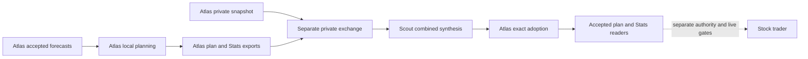

# Atlas: Gameplan lifecycle

**Status: completed Atlas inspection, October 11, 2026.** Existing evidence supports accepted combined planning for action date **October 12**, using completed review session **October 9**. It does not establish current trader liveness, execution permission or actual trading results. Read the [shared Gameplan chapter](../gameplan.md) for the contract and [Atlas nightly workflow](nightly-workflow.md) for orchestration.

Atlas identity comes from the verified local profile and pinned coordination release. Native observations were captured **October 11 00:33:50 PDT**, source **00:34 PDT**, configuration **00:34–00:36 PDT**, and saved outcomes **00:37:35 PDT**. Pacific time is UTC−07:00 on these dates. Ducketz HEAD was `90704d21801f60426493bd6cc650a7fac38d4f61` with pre-existing working changes; source, configuration, registration, process presence and saved outcomes remain separate evidence tiers. [G1–G4]

## Local responsibility and inputs

The current profile/configuration binds Atlas's research partition separately from the combined execution-account universe. Atlas prepares its own forecast/plan/Stats exports, supplies the account-wide snapshot to the private exchange, and adopts Scout's exact returned synthesis. The accepted union includes both disjoint research partitions. Exact membership and private bindings remain local. Scout's independently published [companion](https://github.com/jeremysecondstate/atlas-scout/blob/8b1ef9d547adbaa8ece26de585ce0ef126c70215/system-details/scout/gameplan.md) describes Scout; it is not an Atlas installation receipt. [G1, G2, G4]

| Inspected input/output | Binding and applicability | Evidence boundary |
| --- | --- | --- |
| Latest local forecast | `STOCK_ONLY`, independent stock targets, raw-direction probability target, archive history and XNAS archive prices; binds a Loop B run | Independent Gameplan forecasting uses Loop B inputs, not merely copied probabilities. |
| Strategy/OPRA relationship | Latest receipt has no Strategy publication; source still validates required OPRA history cursors | Skipping Strategy does not remove every options-history readiness dependency. |
| Local cash-aware planning v4 | Exact forecast receipt and action date; 264 frozen forecast rows | `REVIEW_ONLY_REVALIDATE_AT_ENTRY`, broker orders disabled; hypothetical planning is not live reservation. |
| Two owner packages | Explicit producer, compatible dates/contracts, disjoint universes; 264 forecasts in each inspected package | Canonical content/package digests and selected file hashes matched; generation revision remains `UNRECORDED` in both. |
| Two Stats packages | Exact reviewed session, producer/scope and digest | Both selected October 9 packages explicitly carry no eligible saved-history baseline. |
| Atlas snapshot and joint plan | Selected account scope, clock and exact private content bindings | Historical snapshot age at saved synthesis was 157.246 seconds; this does not establish freshness now. |
| Accepted plan/Stats/readiness | Immutable accepted object, dated selection, handoff receipt and pinned downstream files | Retained planning adoption, not rendered pixels, current broker truth or trading success. |

Table: G2–G4. Source retains session/horizon, availability and pre-opening information boundaries; local symbol choices do not redefine those shared target contracts. Planning estimates and frozen intents remain distinguishable from the separate consumer's eligibility, risk, submission, fill and reconciliation stages. [G3]

## Installed task relationships

All Codex rows below were ACTIVE at **00:33:50 PDT**. Recurrence is nominal Pacific scheduling, independently corroborated with the native database; it does not prove a wake or completed stage. [G2]

| Logical task | Pacific recurrence | Model / effort | Relationship |
| --- | --- | --- | --- |
| Atlas Datastore Catch-up | Mon–Fri 21:05 | `gpt-6-luna` / low | Data/history prerequisites through `ml.nightly_workflow` |
| Atlas Gameplan Stats; Model Review Training and Predictions | Each Mon–Fri 03:00 | Each `gpt-6-luna` / low | Stats first, separately configured Astra/high structured review, then numerical prediction/training |
| Atlas Local Gameplan | Mon–Fri 03:00 | `gpt-6-luna` / low | Local planning responsibility against accepted forecast source |
| Atlas Ducketz Display and Readiness | Mon–Fri 03:35 | `gpt-6-luna` / low | Local verification/export, accepted combined-reader readiness and dated notices |
| Atlas Joint Gameplan Handoff and after-midnight companion | Mon–Fri 21:00–23:40 every 20 minutes; Tue–Sat 00:00/00:20/00:40 | `gpt-6-astra` / ultra | `tools.nightly_exchange`; supplies private inputs and adopts/verifies Scout's exact returned plan/Stats |
| Atlas Priority Source Reconciliation and after-midnight companion | Same evening/after-midnight windows | `gpt-6-astra` / ultra | Source/repair ownership and separate supervision ledger; not a planning model |
| Atlas Trader Representative | Mon–Fri 03:55, then 04:05 hourly through 17:05 | `gpt-6-sol` / ultra | Downstream worker/readiness observation. Its conditional guarded-launch grant has separate installation/control prerequisites; the final wake is closed-session audit. No launch occurred here. |

The native Windows dispatcher is enabled and selects eligible preparation stages between checkpoints. The historical 03:55 Windows stock-session registration is disabled. Task prompt authority is not proof that a safe launcher is installed or that the worker ran; those separate limits remain in [Atlas Loop C and stock-execution observations](loop-c.md). Shared planning publication does not override trader controls. [G2]

## Saved chronology and acceptance

All times below are PDT. These are original saved events, inspected **October 11 00:37:35**, not fresh workflow actions. [G4]

| Original event | Time | Meaning |
| --- | --- | --- |
| Latest immutable local forecasts published | October 9 23:43:02 | October 12 forecast edition, advisory/paper authority, broker orders disabled |
| Training/prediction segment complete | October 9 23:44:59 | Saved native report/output identity, not subsequent planning completion |
| Local account-aware plan complete | October 10 00:04:15 | Forecast-bound planning v4 with accumulate-bullish/sell-on-bearish/no-scheduled-expiry holding policy |
| Local display check and export complete | October 10 00:08:29 / 00:08:31 | Preparation remains terminal `LOCAL_COMPLETE_PEER_SETUP_PENDING` |
| Selected snapshot observed / Scout synthesis `as_of` | October 10 03:22:09 / 03:24:46 | Snapshot clock and returned synthesis; financial values were not published |
| Atlas joint-plan acceptance | October 10 03:25:51 | Exact immutable accepted object and dated pointer agree; this is not an intrinsic completion timestamp on the separate handoff receipt |
| Separate exchange saved status | File modified October 10 03:25:58 | `COMPLETE`, local `HANDOFF_VERIFIED_LOCAL`, joint/UI/peer true. File modification is not an intrinsic completion field. |
| Saved final supervision verification | October 10 08:42:04 | `FINAL_VERIFIED`, exact dated plan/Stats references; historical observer result |

The returned Scout synthesis receipt records `JOINT_READY_LOCAL` and peer verification false at that earlier layer. Atlas handoff and terminal exchange later establish their own acceptance layer. Both records remain intact; the earlier flag is not rewritten as if peer verification occurred then. The accepted joint plan is `INFORMATIONAL_ONLY`, with live-order authorization and live-capital reservation false. Exchange retains execution authorization false and activation unchanged. [G4]

The audit verified local forecast/planning manifests, two packages' canonical digests, exact selected references, the accepted plan's canonical digest and five pinned downstream files. Across this and the other documentation topics, 275 saved artifact/hash comparisons passed. It did not replay synthesis, validate all account/financial semantics, rescore models, refresh the snapshot, render the UI or test the trader. [G4]

## Provenance, discrepancies and limits

Both selected packages explicitly mark their generation source revision **UNRECORDED**, with source revision/reference null. Artifact hashes bind the saved outputs but cannot supply that missing generation provenance. The current 376-Python-file aggregate differs from the completed preparation's aggregate despite identical HEAD. Detailed identities and their limited file scope are in [Atlas nightly workflow](nightly-workflow.md). [G4]

The installed supervision helper/manifest/guide match the three exact hashes pinned by native prompts. However, two of its 15 reviewed dependency hashes differ today: `app/ui/gameplan_data.py` and `app/ui/gameplan_stats_data.py`. That does not prove the historical accepted plan is wrong, but the old installation receipt does not re-certify today's reader dependency set. No helper or current semantic validator was executed in this pass. [G2]

A bounded process snapshot found the UI launcher/interpreter pair and no matching preparation/exchange/stock worker. It does not prove global absence or current loaded-module hashes. Saved reader acceptance and an extant UI process are separate observations. The earlier [Loop C chapter](loop-c.md) retains distinct stock-session outcomes; successful later planning is not evidence that that trading session succeeded. [G2, G4]

## Evidence index and privacy

| Ref | Evidence / observation | Limits |
| --- | --- | --- |
| G1 | Local profile, coordination manifest and baseline ownership; October 11 00:31–00:33 | Verified Atlas identity; exact research membership private |
| G2 | TOML/native DB/Windows/process capture 00:33:50–00:33:52; source/config capture 00:34:43; supervisor dependency review 00:35:17; binding readback 00:36:32 | Installed definitions/configuration and bounded liveness only |
| G3 | Gameplan/target/handoff/adoption/planning source snapshots 00:34:09–00:34:11; [shared evidence register](../gameplan.md) | Current working implementation, some modified/untracked at HEAD |
| G4 | Private runtime `evidence.json`, `hash-checks.json`, inventory and inspection script; 00:37:35 | Retained bytes and selected bindings, not full semantic execution or independent current Scout inspection |

Exact memberships, account scopes, native IDs, local paths, private packet selections and receipts remain in Atlas's dated private report. The scaffold's empty status is superseded by this inspection; earlier source/session observations retain their dates. No application source, operating bindings, schedules, controls or workers were changed.

[System details index](../README.md) · [Atlas Stats](stats-and-feedback.md) · [Atlas scheduled tasks](scheduled-tasks.md)
