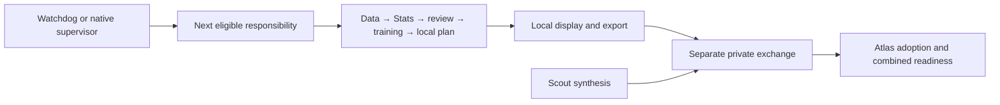

# Atlas: Nightly workflow and recovery

**Status: completed Atlas inspection, October 11, 2026.** Saved October 12 action-date preparation and later combined planning exchange are complete at their respective evidence layers. This does not establish a running trader or future schedule success. Read the [shared workflow](../nightly-workflow.md), [Stats](stats-and-feedback.md) and [Gameplan](gameplan.md) chapters for their contracts.

Observations: native definitions **October 11 00:33:50 PDT**, source/configuration **00:34–00:36**, saved outcomes **00:37:35**. Local time is America/Los_Angeles (UTC−07:00 on these dates). The verified coordination profile identifies Atlas; pinned manifest and 29 declared release files match. Application HEAD is `90704d21801f60426493bd6cc650a7fac38d4f61`, with 174 pre-existing working changes preserved. This is not a clean application-deployment assertion. [N1–N4]

## Local stage ownership

The split layout has seven steps: `datastore_catchup`, `prepare_stats`, `model_review`, `train_and_plan`, `local_gameplan`, `verify_display`, `local_handoff`. Five logical owners supervise these dependencies; they are not five fixed-time numerical jobs. The enabled dispatcher can advance stages between checkpoints. Configuration selects archive history/XNAS prices, profile/watchlist binding and automatic recovery capped at three attempts under recorded authority. [N2, N3]

The structured reviewer is **`gpt-6-astra` / high**, with a 1,800-second ceiling further bounded by deadline. It consumes frozen diagnostics; numerical fitting, assessment, promotion and prediction are separate. Preparation's `peer_communication_enabled=false` leaves transport to the separately configured, locally authorized private exchange. Atlas supplies its research exports and account snapshot and adopts Scout's exact synthesis. These roles do not grant execution authority. [N2–N4]

## Installed task relationships

Observed **00:33:50–00:33:52 PDT**. Fifteen saved Codex definitions match native database settings/prompt hashes: ten ACTIVE, five PAUSED. Native IDs/full bindings remain private. [N2]

| Task/component | State and nominal Pacific recurrence | Model / effort | Relationship / entry point |
| --- | --- | --- | --- |
| Atlas Datastore Catch-up | ACTIVE; Mon–Fri 21:05 | Luna / low | `ml.nightly_workflow`, datastore responsibility; data/history prerequisites |
| Atlas Gameplan Stats | ACTIVE; Mon–Fri 03:00 | Luna / low | Stats checkpoint; dispatcher advances numerical work after catch-up; owns dated 03:00 risk notice |
| Atlas Model Review Training and Predictions | ACTIVE; Mon–Fri 03:00 | Luna / low | Model responsibility after Stats; separate Astra/high reviewer and numerical worker |
| Atlas Local Gameplan | ACTIVE; Mon–Fri 03:00 | Luna / low | Planning after accepted forecast publication |
| Atlas Ducketz Display and Readiness | ACTIVE; Mon–Fri 03:35 | Luna / low | Local verification/export, combined-reader readiness and missed-confirmation notice |
| Atlas Joint Gameplan Handoff | ACTIVE; Mon–Fri 21:00–23:40 every 20 minutes | Astra / ultra | `tools.nightly_exchange`; private transport/adoption; one prerequisite-aware dispatch when needed |
| Handoff after-midnight companion | ACTIVE; Tue–Sat 00:00/00:20/00:40 | Astra / ultra | Same logical responsibility/receipts; distinct native definition |
| Atlas Priority Source Reconciliation | ACTIVE; Mon–Fri 21:00–23:40 every 20 minutes | Astra / ultra | Source/request intake, owned repairs, sole writer of installed supervision continuation ledger |
| Source after-midnight companion | ACTIVE; Tue–Sat 00:00/00:20/00:40 | Astra / ultra | Same evening/owner/repair continuity; distinct native definition |
| Atlas Trader Representative | ACTIVE; Mon–Fri 03:55, then 04:05 hourly through 17:05 | Sol / ultra | Downstream observation; conditional guarded-launch authority has separate prerequisites. Final wake audits close. |
| Temporary overnight-recovery completion follow-up | PAUSED; retained five-minute heartbeat | Existing chat, no saved override | Prior recovery conversation, not ordinary recurrence; no queued next wake |
| Loops Gameplan Weekly Review | PAUSED; retained Saturday 09:00 | 5.6 Luna / medium | `ml.gameplan_evaluation`, mature saved forecasts; historical Loop C identity is not literal Loop C execution |
| Loops Overnight Gameplan | PAUSED; retained daily 21:05 | Astra / ultra | Historical monolithic `ml.overnight_runtime` launcher |
| Hyperliquid Operations Watch | PAUSED; retained every 30 minutes | Luna / xhigh | Separate digital-asset stack |
| Hyperliquid Paper Improvement | PAUSED; retained every two hours | Luna / max | Separate paper research |
| Windows nightly responsibility dispatcher | Enabled/Ready; daily 21:05, five-minute timer, logon | None | `tools.nightly_watchdog` → `ml.nightly_workflow --dispatch`; one eligible local responsibility |
| Windows independent stock session | Disabled; retained Mon–Fri 03:55 | None | Historical stock-session action; a next timestamp does not activate it |
| Windows completed-chat cleanup | Enabled/Ready; five-minute timer, logon | None | Completion housekeeping, not numerical or trader supervision |
| Installed supervision observer | Component of existing source/handoff tasks; no extra native schedule | None | Read-first state/acceptance inspection; Priority may record its bounded ledger, Joint inspects only |

Luna/Astra/Sol mean `gpt-6-luna`, `gpt-6-astra`, `gpt-6-sol`; the weekly legacy model is `gpt-5.6-luna`. Recurrence is configuration evidence, not proof of any completed stage. [N2]

Saved recurrence strings lack `TZID`; prompts/workflow and native epochs corroborate Pacific intent. Windows reports the DST-aware `Pacific Standard Time` zone. Local triggers follow Pacific wall time; interval triggers repeat elapsed minutes. No future DST transition was tested. The dispatcher uses IgnoreNew, StartWhenAvailable, WakeToRun and a three-minute invocation ceiling, which does not limit its numerical worker. Interactive-user/machine availability, desktop supervision and authenticated reviewer CLI capacity remain separate prerequisites. [N2, N3]

At readback, dispatcher last ran **00:33:25**, result zero; cleanup **00:33:29**, result zero. The disabled stock task retains a September 15 result one. These are launcher outcomes, not workflow completion. [N2]

## Calendars and recovery

Source selects the newest completed XNYS session after its 17:00 Pacific action-day boundary, next exchange session as action date, source-date 21:05 kickoff and action-date 04:00 original deadline. The saved October 12 run uses Friday October 9, so its deadline is Monday 04:00. Weekend observer wakes can retain that result. Current evening windows exclude new wakes at or after 01:00 and Sunday evening; they do not terminate already owned work. [N2–N4]

Wake/workflow/native-runtime locks and renewable supervision serialize work. Source freezes configuration, scope, application identity and output hashes, records native attempts before execution, and reuses exact complete receipts/review answers. Process identity/creation-time checks precede interrupted-owner recovery; a stale filename or reused PID is not takeover authority. [N3]

Transient retry has five-minute backoff and bounded attempts. External prerequisites stay resumable; deterministic defects require reviewed repair. Preparation/exchange share a persistent repair owner with no expiry takeover. Missed-night recovery adds a frozen deadline within seven hours and action-day 17:00 while retaining the original deadline. Separately authorized planning-tail continuation does not silently extend ordinary work or rerun earlier training. These capabilities were read, not exercised. [N3]

## Saved outcomes and preserved history

The private audit covered three preparation states, 26 Stats publications, four reviews, selected forecast/planning packages and combined acceptance references. All **275 saved artifact/hash comparisons** passed; no application validator, live reader or production stage was invoked. [N4]

| Evidence layer | Saved fact | Meaning |
| --- | --- | --- |
| Latest local preparation | October 9 21:05:03 start; October 10 00:08:31 complete | Seven split steps COMPLETE, one attempt each; 24 recorded step-output references match |
| Local terminal label | `LOCAL_COMPLETE_PEER_SETUP_PENDING`, no owner PID | Original component result; does not establish peer setup remains absent |
| Returned Scout receipt | `JOINT_READY_LOCAL`, local UI ready, peer verification false at that layer | Preserved peer-produced synthesis evidence |
| Atlas plan acceptance | October 10 03:25:51 | Immutable accepted object/dated pointer agree; not a completion timestamp intrinsic to the handoff receipt |
| Separate exchange | `COMPLETE`, `HANDOFF_VERIFIED_LOCAL`, joint/UI/peer true | Saved combined planning; execution authorization false, activation unchanged |
| Final supervision | October 10 08:42:04; `FINAL_VERIFIED`, overall complete | Historical saved verifier/reader evidence |
| Watchdog | October 11 00:33:26; dispatch false, changed false | Retains completed dated preparation; subsequent timer observations are separate |

October 8 and 9 action dates retain the older **five-step** layout. October 8 local completion was 00:13:33; October 9 completed at 13:19:41 after its original 04:00 deadline. The latter retains explicit missed-launch recovery, seven source-repair transitions and a separately bound planning-tail continuation. Those exceptional records do not generalize into automatic deadline extension; this pass did not fully revalidate the old repair chain. [N4]

Current aggregate over **376 Python files** is `ea1edfb927f743b3ff6435583cecd91f80c6a72413de541e8e7da428d6ea3988`; latest preparation records `e52fbf441aaf30d464fa2566cd216bacaecc5eccf9a14d74bf1d90db7429a8fa`. All three saved states share today's HEAD but have different aggregates. The map covers only `ml`, `datafetching`, `app` Python. Tools, launchers, configs and other files need separate evidence; historical per-file maps were unavailable in the states. Old success does not validate today's bytes. [N4]

## Dependency drift and process limits

At **00:35:17**, installed supervision helper/guide/manifest matched their three pinned hashes. Only **13 of 15** reviewed dependency hashes match: `app/ui/gameplan_data.py` and `app/ui/gameplan_stats_data.py` differ today. The old installation record therefore does not attest the complete current dependency set. This is a compatibility-evidence gap, not proof the historical accepted plan failed. The helper was not invoked. [N2]

The installed guide still mentions five-minute native wakes; current prompts/definitions establish twenty-minute model-task windows. The separate Windows dispatcher remains five-minute. Earlier daily checkpoints in [scheduled tasks](scheduled-tasks.md) and Loop A history remain dated observations; Atlas now has weekday checkpoints. [N2]

The bounded process scan found the UI launcher/interpreter pair born October 10 03:39:11 and no matching nightly, exchange or stock worker. It establishes neither global absence nor loaded-module hashes. Process presence and saved reader acceptance remain different evidence. [N2]

## October 11 follow-up: scheduling versus reader verification

The earlier **00:35:17** comparison above checked the original supervisor installation manifest only. It correctly found 13 of 15 original dependency hashes unchanged. Further read-only investigation at **01:30:03–01:31:59 PDT** found a separately retained UI installation and dependency-transition addendum that the first pass had not included. This narrows the earlier compatibility-evidence gap. [F1, F2]

The two changed readers exactly match [reviewed UI source `3ff1c583`](https://github.com/jeremysecondstate/ducketz/commit/3ff1c5833e3acd8d2bcd3278c90e4de8987e635e), committed October 10 00:42:15 PDT. `app/ui/gameplan_data.py` preserves accepted historical sessions while a current combined plan is pending and explains the missing intended-date selection; it retains the guard against substituting a local projection for the shared account plan. `app/ui/gameplan_stats_data.py` exposes the saved `coverage_status` for an unscored session; it does not change forecast eligibility or scoring. These are reader changes, not recurrence changes. [F1]

The addendum, recorded **October 10 03:32:44 PDT** and hash-pinned by the retained source-owner handoff, binds the unchanged original helper/manifest/guide, the exact **03:30:30 PDT** UI installation, the two changed reader dependencies and the thirteen unchanged dependencies. **All 15 current dependency hashes match that combined baseline-plus-addendum record**, and all nine installed UI files match their installation receipt. Its referenced saved **119-pass** test record/log, installation plan and installation readback also match their recorded hashes. These are checks of existing evidence, not tests rerun by this documentation task. [F2]

The addendum retains an independent post-install verification summary at **October 10 03:31:16 PDT**, including loaded-reader identities, `FINAL_VERIFIED`/overall complete and agreeing default/dated reader summaries. The original detailed independent-review JSON is unavailable at its archived-worktree path and was not recovered in the bounded search; its recorded raw-file hash could not be reverified. Therefore the saved addendum documents the transition and historical verification, with that evidence-retention limit. This follow-up does not newly certify current loaded modules, rendered UI, broker state or runtime health. The original installation manifest was intentionally preserved, not rewritten. [F2]

Native schedule changes are a separate history. Fresh **01:30:18 PDT** readback confirms the five preparation checkpoints now use Monday–Friday eligibility at their retained wall times, and source/handoff model tasks use the recorded twenty-minute overnight windows. The installed guide's five-minute native-task description is older wording; the Windows dispatcher still has a five-minute timer. All fifteen saved definitions and three Windows registrations match the earlier October 11 readback. See the [current scheduling clarification](scheduled-tasks.md#october-11-schedule-and-source-clarification). [F3]

| Ref | Follow-up evidence and observation | Limit |
| --- | --- | --- |
| F1 | Original-manifest reader hashes matched retained Git blobs; current reader blobs matched `3ff1c583`; exact normalized diff inspected at 01:30:03 | Explains code content, not a schedule-edit cause or present loaded source |
| F2 | Saved append-only transition, original supervisor, UI install/test records and current file hashes; 01:31:59 | All 15 dependency and nine installation-file comparisons match; original detailed independent-review file unavailable |
| F3 | Native TOML/DB and Windows XML/state readback 01:30:18; historical weekday revision records/comparison 01:31:14 | Configuration and history only; no schedule or operating change |

The older completed-run source aggregate and feedback-policy comparisons elsewhere in these chapters keep their original meaning. A reader dependency addendum neither rewrites historical generation provenance nor authorizes a stale feedback proposal for fresh training. It also does not establish a new trading outcome.

## Evidence index and privacy

| Ref | Evidence/source | Observation and scope |
| --- | --- | --- |
| N1 | Private baseline, active/profile/manifest verification | October 11 00:31–00:33; identity/base and 174 other-writer files preserved |
| N2 | TOML/native DB/Windows XML/process capture; binding and installed-supervision readback | 00:33:50–00:36:32; installed definitions/configuration and bounded presence |
| N3 | `ml/nightly_dispatch.py`, `ml/nightly_workflow.py`, `ml/overnight_runtime.py`, recovery/repair/readiness modules; watchdog/exchange/notification source | Root snapshot 00:34:11, native source snapshot 00:34:43; [shared source register](../nightly-workflow.md) separates working bytes from HEAD |
| N4 | Private runtime evidence, hash checks, inventory, source map and read-only audit script | 00:37:35; saved bytes/selected bindings, not every market input, financial semantic, loaded model or rendered UI |

Exact native IDs, symbols, paths, account bindings, definitions and receipts remain private. [Scout's reviewed companion](https://github.com/jeremysecondstate/atlas-scout/blob/8b1ef9d547adbaa8ece26de585ce0ef126c70215/system-details/scout/nightly-workflow.md) remains independently attributed. Earlier observations preserve their dates; the scaffold had no runtime findings. No application source, schedules, controls, bindings or workers changed.

[System details index](../README.md) · [Atlas Stats](stats-and-feedback.md) · [Atlas Gameplan](gameplan.md)
