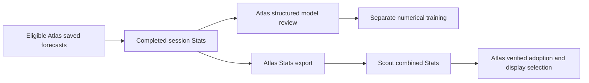

# Atlas: Stats and model feedback

**Status: completed Atlas inspection, October 11, 2026.** Read the [shared Stats chapter](../stats-and-feedback.md) for the common contract. This companion records independently inspected Atlas evidence; Scout's [separate reviewed chapter](https://github.com/jeremysecondstate/atlas-scout/blob/8b1ef9d547adbaa8ece26de585ce0ef126c70215/system-details/scout/stats-and-feedback.md) is not evidence of Atlas configuration.

Source was frozen **00:34 PDT**, native definitions **00:33:50 PDT**, and saved runtime evidence **00:37:35 PDT** on October 11 (`America/Los_Angeles`, UTC−07:00). These are inspection times, not launch/completion times. The verified local coordination profile identifies Atlas. Its pinned manifest and all 29 declared release files match. Ducketz HEAD was `90704d21801f60426493bd6cc650a7fac38d4f61`, with 174 pre-existing modified/untracked files preserved. Some inspected modules are local working source rather than that committed revision. [A1–A3]

## Responsibility and evidence flow

Atlas prepares Stats for its local research partition before model review and training, exports the exact Stats package with its plan, and adopts the combined Stats selected through Scout synthesis and Atlas handoff. Research membership is bound privately to the profile/watchlist; combined coverage is the disjoint two-producer union. This describes source/configuration and retained publications, not current trading performance. [A1–A4]

| Input/output | Meaning and downstream boundary |
| --- | --- |
| Eligible independent forecasts and saved plan | Actuals selection retains the edition saved before the reviewed session's 04:00 Pacific opening; later plans cannot become earlier eligible history. |
| Actual market observations | Completed-session cutoff is 17:00 Pacific; maturity/price-source/availability and boundary checks still apply to each target. |
| Local daily Stats | Outcomes, planning-price comparisons, report, manifest and receipt; numerical completion can legitimately publish an explicit no-history baseline. |
| Model-review diagnostics/proposal | Bound to exact Stats receipt/report/results and nine source-policy hashes; a proposed candidate is not a fitted or promoted model. |
| Local/combined Stats packages | Producer, session, scope, target semantics and byte/reference checks precede accepted combined publication and downstream readers. |

Source details are in the shared chapter's evidence register, especially `ml/gameplan_actuals_review.py`, `ml/gameplan_model_feedback.py`, `ml/gameplan_stats_handoff.py` and `app/ui/gameplan_stats_data.py`, inspected at the source time above. [A3]

## Installed task relationships

Saved TOMLs and native database readback agreed at **00:33:50 PDT**. All rows below are ACTIVE; recurrence is scheduling evidence, not completion. Pacific intent comes from prompts/configuration and native epochs; the saved recurrence strings do not themselves carry a timezone identifier. [A2]

| Logical task | Pacific recurrence | Model / effort | Relationship and entry point |
| --- | --- | --- | --- |
| Atlas Datastore Catch-up | Mon–Fri 21:05 | `gpt-6-luna` / low | `ml.nightly_workflow`, datastore responsibility; prerequisite data/history segment |
| Atlas Gameplan Stats | Mon–Fri 03:00 | `gpt-6-luna` / low | Stats responsibility; `prepare_stats` and the dated readiness-risk responsibility |
| Atlas Model Review Training and Predictions | Mon–Fri 03:00 | `gpt-6-luna` / low | Model responsibility; follows Stats, invokes separately configured reviewer then numerical training |
| Atlas Joint Gameplan Handoff, plus after-midnight companion | Mon–Fri 21:00–23:40 every 20 minutes; Tue–Sat 00:00/00:20/00:40 | `gpt-6-astra` / ultra | Separate `tools.nightly_exchange` responsibility carrying plan/Stats and verifying exact acceptance |
| Atlas Ducketz Display and Readiness | Mon–Fri 03:35 | `gpt-6-luna` / low | Display responsibility, saved readiness and missed-confirmation notice |

The independently configured structured reviewer is **Astra/high**, bounded to 30 minutes and the earlier workflow deadline. It receives saved diagnostics; the scheduled supervisor's Luna/low setting is a different role. The enabled Windows dispatcher can advance prerequisites between these checkpoints. Full dispatcher, paused legacy and separate follow-up distinctions are in [Atlas nightly workflow](nightly-workflow.md). [A2, A3]

## What the saved evidence establishes

The read-only audit covered **26 retained actuals-review publications**, selected outcome columns and recorded manifest/receipt/output hashes. It did not rerun scoring or recompute historical prices. All 275 recorded artifact/hash comparisons across the broader Stats/Gameplan/workflow audit passed; that is not 275 independent production runs. [A4]

| Reviewed session / publication in PDT | Retained outcome | Interpretation |
| --- | --- | --- |
| October 7 combined; October 8 00:23:36 | 528 rows: 273 evaluated, 132 pending maturity, 123 awaiting data | Atlas's retained combined artifact; its local publication time differs from Scout's synthesis time. |
| October 8 local; October 9 06:59:55 | 264 rows: 166 evaluated, 66 pending, 32 awaiting data | Late completed-session review, preserving the real clock and unavailable outcomes. |
| October 8 combined; October 9 13:23:13 | 528 rows: 270 evaluated, 132 pending, 126 awaiting data | Accepted combined results, distinct from Atlas-only scores. |
| October 9 local; October 9 22:48:28 | Zero rows; `NO_SAVED_INDEPENDENT_GAMEPLAN` | No eligible pre-opening saved independent edition for this review session. |
| October 9 combined; October 10 03:25:51 | Zero rows; both producers report that baseline | Latest/dated selection retains a completed publication with no score, not zero accuracy. |

The separate cumulative evaluator retains **7,944 rows**: 6,322 evaluated, 1,457 awaiting data and 165 pending; 7,056 are promoted. Its population mixes 3,456 legacy cost-adjusted target rows and 4,488 raw-direction rows. All-row completion, promoted populations and scored directional denominators are different quantities; they cannot substitute for the empty latest daily edition. [A4]

UI directional accuracy measures saved bullish/bearish calls against raw price movement. Neutral evaluated rows may contribute probability/Brier evidence but not a directional call. Pending, missing and unpromoted rows do not become UI performance. The cumulative evaluator's historical `direction_accuracy` instead describes threshold classification against that edition's binary target; `raw_direction_accuracy` is separately retained. Planning errors/range coverage score hypothetical estimates, not realized fills or account performance. [A3]

## Review history and current-source limits

All four retained review proposals matched their diagnostics and bound Stats files. The latest review, **October 9 22:53:40 PDT**, records `KEEP_CURRENT` with no candidates for every horizon against the no-history baseline. Two earlier Atlas reviews, **October 9 07:01:30 and 08:05:14**, each propose one hourly `EVALUATE_CANDIDATES` candidate; other horizons retain current settings. Do not copy Scout's different review history into Atlas. A candidate proposal alone proves neither fitting nor promotion. [A4]

The latest review differs from today's working bytes in **one of nine** bound policy files, `app/ui/gameplan_stats_data.py`. Three earlier reviews also differ in `ml/nightly_gameplan.py`. Ordinary fresh training reuse requires current policy/Stats identity; terminal historical attestation can preserve the original accepted decision but never feeds new training. [A3, A4]

The latest local preparation completed for action date **October 12**, using reviewed session **October 9**. Its retained local status remains `LOCAL_COMPLETE_PEER_SETUP_PENDING`; a separate exchange record is `COMPLETE` with joint/UI/peer verification true and execution authorization false. The accepted combined Stats selection and five pinned downstream publication files were byte-checked. This is saved planning acceptance, not a fresh rendered UI test, broker reconciliation or live worker certification. [A4]

## October 11 follow-up: reader revision versus scheduling

At **01:30:03–01:31:59 PDT**, exact source and saved installation/addendum evidence explained the current Stats reader revision: [reviewed UI source `3ff1c583`](https://github.com/jeremysecondstate/ducketz/commit/3ff1c5833e3acd8d2bcd3278c90e4de8987e635e) adds the saved `coverage_status` to the reader result so the display can explain an unscored session. It does not change scoring or pre-opening eligibility. The [nightly follow-up](nightly-workflow.md#october-11-follow-up-scheduling-versus-reader-verification) documents the exact supervisor dependency transition and remaining unavailable-original-review-file limit.

This explains why the reader hash changed; it does not erase the earlier one-of-nine policy mismatch or make an old feedback review valid for fresh training. Separately, the five preparation checkpoints changed from daily to weekdays while retaining their wall times. [Fresh native readback](scheduled-tasks.md#october-11-schedule-and-source-clarification) at **01:30:18 PDT** confirms those settings. A schedule correction does not alter historical Stats eligibility, manufacture missing forecasts or repair an absent score.

## Evidence index, history and privacy

| Ref | Evidence and observation | Scope/limit |
| --- | --- | --- |
| A1 | Local profile, active release/manifest, repository baseline; October 11 00:31–00:33 PDT | Atlas identity and pinned coordination bytes, not application deployment |
| A2 | Fifteen saved Codex TOMLs/native DB readback and Windows readback; 00:33:50; configuration and installed supervisor dependencies 00:35–00:36 | Installed definitions/configuration, separate from scheduled outcomes |
| A3 | Current Stats/feedback/UI/target source snapshots; 00:34:09–00:34:11; shared chapter's source register | Modified/untracked source clearly separated from HEAD; no process-loaded-byte claim |
| A4 | Private `evidence.json`, `hash-checks.json`, runtime inventory and read-only inspection script; 00:37:35 | Saved output hashes, selected Parquet status/contract columns, review bindings and acceptance links; not every historical raw input or semantic validator |

Exact paths, memberships, native IDs and receipts are in Atlas's dated private documentation report and evidence directories. The earlier scaffold contained no findings; historical publications above remain separately dated. The [scheduled-task chapter](scheduled-tasks.md) preserves earlier observations, including schedules subsequently revised. No operational work or controls were changed to produce this report.

[System details index](../README.md) · [Atlas Gameplan](gameplan.md) · [Atlas nightly workflow](nightly-workflow.md)
