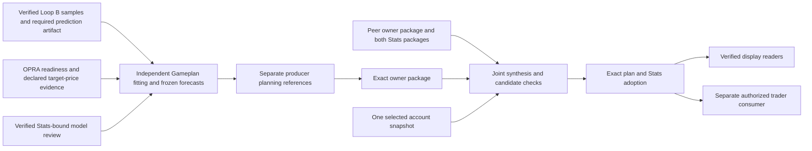

# Gameplan lifecycle

**Status: reviewed shared implementation reference, October 11, 2026.** Atlas owns this shared source explanation. The [Atlas companion](atlas/gameplan.md) and [Scout reviewed companion](https://github.com/jeremysecondstate/atlas-scout/blob/8b1ef9d547adbaa8ece26de585ce0ef126c70215/system-details/scout/gameplan.md) separately establish installed responsibilities and saved outcomes. A common implementation, accepted plan or peer report does not establish either PC's current process state.

The evidence is a **00:34–00:36 PDT (07:34–07:36 UTC), October 11, 2026** snapshot of Ducketz HEAD `90704d21801f60426493bd6cc650a7fac38d4f61` with pre-existing changes. Several central interfaces are modified or untracked; the private source inventory records SHA-256, observation time and Git status for the exact working bytes. No runtime import, provider/broker request, model load or workflow was performed.

## Purpose and distinct publications

Gameplan turns accepted research evidence into immutable forecasts, adds separately identified planning estimates, and can combine two research producers against one account snapshot. These are different outputs with different acceptance rules. The forecast generator trains and freezes its own target models; it does not merely copy Loop B probabilities. Forecast publication, model promotion, local planning completion, joint acceptance, display readiness and execution permission are separate facts. [G1, G4–G8]

The diagram describes the independent-stock and joint-planning path. Source also retains a stock-and-options research path that reads Strategy candidates and constructs option intents. `stock_only` skips that Strategy publication, but **still invokes OPRA history cursor validation** before fitting. Stock-only publishes explicit non-executable option placeholders. Named Loop C's observe-only Strategy/risk lane and the separate stock executor have their own boundaries; neither is synonymous with Gameplan preparation. [G1, G4]

## Inputs, clocks and lineage

| Input | Direct use and checks | Boundary |
| --- | --- | --- |
| Accepted Loop B publication | Authoritative current reader verifies publication identity; Gameplan requires both samples and predictions artifacts and derives its configured symbol/feature scope from the publication. | Samples supply causal features; Gameplan builds its own targets and models. |
| Loop A and ancillary data | Reach Gameplan through Loop B sample lineage and separately loaded declared price/archive evidence. | The inspected Gameplan entry does not directly inspect a current Loop A complete-generation pointer. Upstream workflow readiness is a separate responsibility. |
| OPRA history | Each configured symbol and required schema needs readable sufficiently current cursor evidence; replay coverage is verified when present. | This readiness dependency remains in stock-only source despite no Strategy input. |
| Target-price evidence | Declared source contract/dataset and exact minute-boundary rules, retained in targets/publications. | Daily features and synthetic planning references cannot replace observed target endpoints. |
| Stats and model review | Exact Stats plus policy-source identities when a feedback review is supplied; the workflow's review prerequisite is documented separately. | The standalone generator's feedback parameter is optional; inspection of that interface does not prove an installed task bypasses review. |
| Strategy publication | Required by the broader stock-and-options research mode, omitted by stock-only mode. | Pricing and captured option data have indirect lineage through Strategy in that broader mode. |

These dependencies are source findings, not proof that today's pointers are accepted or that an installed worker loaded this source. Loop B's receipt-era reader validates the selected pointer/receipt/manifest relationship; generic manifest validation checks recorded outputs, not a fresh derivation of every historical input. [G1, G10]

The operational prior-session selector requires an eligible full hourly bar on its declared XNAS/XNYS session, starting after the regular open and ending between the actual regular close and 17:00 Pacific. Features must be available by the earlier of the run cutoff and source-session **17:05 Pacific**. That source maps only to the immediately following exchange session; contradictory copies fail and a missing session is not bridged silently. [G2]

The archive route uses a distinct source-selection contract. Completed intervals become eligible only after a five-minute processing delay and must carry complete declared source coverage. Core daily features need consecutive observed-session history; missing sessions, known splits, provider-quality exclusions and large unexplained raw discontinuities reset warmup. Historical archive features and operational features are combined under explicit source/quality rules, not presented as live data. Actual information availability and original cutoff remain separate from later evidence-acquisition time. [G1, G2]

Independent-stock forecasts carry 24 rows per researched symbol: thirteen hourly entry windows, a non-entry opening-gap row, four four-action-hour windows, five daily session rows and a first-to-fifth-session weekly window. XNYS identifies sessions; action clocks are 04:00–17:00 Pacific. Outlook and research rows are not execution entries. A target window is an evaluation/allocation identity; the later signal-driven holding policy does not imply a mandatory sale at every target endpoint. Exact local symbol membership stays in private evidence. [G3, G5]

Ordinary new forecast publication must finish before the action session's 04:00 opening. Date-pinned late/recovery paths retain real creation time and an earlier information cutoff, verify their specific authorization/bounds, and do not backdate the artifact. A missed final publication boundary leaves the new immutable pointer unadvanced. Their existence is not general permission to replay a completed session or refresh current account state. [G1, G4]

## Forecasting, calibration and publication

The generator obtains features, loads the declared price source, constructs eligible training targets and saves prior-forecast evaluation independently before the new fit. It fits four horizon groups, with chronological train, selection, calibration and assessment partitions and overlap purging. Independent-stock development compares supported tree, neural, blended and logistic candidates, plus bounded reviewed candidates where provided. Final model selection uses development evidence; assessment checks promotion after selection. [G1]

Raw-price direction and legacy cost-adjusted target semantics remain explicit. Calibration must preserve usable probability information. A promoted model satisfies its versioned numerical gate; the current independent-stock tolerance policy does not assert measured baseline outperformance. A failed challenger may retain a compatible earlier promoted model and its frozen evidence; no compatible model leaves research/unpromoted handling rather than inventing promotion. No fitted model was loaded during this documentation work. See [Stats and feedback](stats-and-feedback.md) for denominators and review reuse boundaries. [G1, G3]

Forecast outputs include frozen rows and IDs/windows, model reports/artifacts, target cohorts, prior-evaluation references, advisory plan data and option-intent rows. Publication verifies its manifest and contract metadata, writes a receipt, then atomically updates the latest pointer. Readers bind manifest, receipt, pointer, action date, probability/source-selection/fallback contracts and advisory safety fields. File integrity is necessary evidence; it is not broker authorization or proof of a completed downstream exchange. [G1, G10]

## Separate planning estimates and producer exports

Trade planning requires a verified independent stock-only forecast, exact source receipt, matched non-executable option placeholders and verified promotion claims. It preserves the forecast identities and adds descriptive planning-price bands/paths. Those historical ranges are not current quotes, order prices or guaranteed future confidence intervals. Explicit sparse-reference policy may carry a closing reference through a bounded covered gap, with synthetic origin/time recorded; it does not manufacture observed intraday target endpoints for Stats. [G4]

There are distinct local planning modes. Account-producer and research-producer modes prepare frozen price references without capturing an account snapshot, assigning holdings, calculating shared cash or assigning account trade quantities. Account-producer mode checks its exact account binding and local producer universe; research-producer mode forbids combining those account inputs. A separate account-aware review path can project from its own snapshot, and an informational refresh reuses its saved snapshot/as-of evidence rather than silently changing the frozen forecast. Which mode ran is a private receipt/native-evidence question. [G4]

The owner-package exporter is an explicitly selected-artifact interface: it does not discover a latest pointer or broker state. It checks the forecast and planning manifests/receipts, stock-only scope, dates, row identities, target/price/fallback contracts and output hashes, then rechecks read inputs for mutation. An allowlist removes account fields and raw historical samples; it retains enough forecast/planning provenance for composition. This shape validation does not itself authorize external export. [G5]

Generation source identity has its own boundary. If manifest and receipt both record a matching source revision, the exporter retains it. An externally supplied revision requires independently selected receipt-bound provenance. With neither, the package must say **`UNRECORDED`**. Today's Git HEAD, successful artifact hashing or a correct content digest cannot recover a missing generation revision. The package can be internally consistent while that provenance remains unavailable. [G5]

## Joint composition, acceptance and adoption

Joint composition takes exactly two independently selected owner packages, explicit disjoint universes/digests, one account-scope-bound snapshot and an explicit sole executor. It validates dates, original 24-row coverage, duplicate identities, price-source/planning-policy compatibility, fallback policy and nonfuture freshness. Default admissibility bounds are fifteen minutes for the snapshot and seven days for packages/planning references; these are source defaults, not claims about local overrides or live quote freshness. [G6]

The composition applies one global cash policy to the combined forecast set. It retains source identities while adding account-aware quantities and conditional cash/holding projections. Every projected event is labeled a conditional planning fill. The result is `INFORMATIONAL_ONLY`, with `live_capital_reserved=false` and `live_orders_authorized=false`. A projected sale funds a projected purchase only under the hypothetical fill/cash assumptions; it cannot release actual reservations or demonstrate a broker fill. [G6]

The current synthesis adapter fixes the sole executor to Atlas and validates the local profile and selected producer packages. It verifies both Stats packages, their preceding review session, timing, target compatibility and original source hashes before composing. The actor companions independently verify each PC's actual local binding; a source constant is not installed authority. [G7]

Synthesis first adopts plan and Stats into an isolated candidate and checks the default readers there. It then adopts those exact outputs locally and verifies readers again. These are sequential operations: a failure after plan adoption records `PARTIAL_ADOPTION`. Retrying retains the same completion identity and exact specification; a changed specification fails. `JOINT_READY_LOCAL` records local joint/UI readiness while retaining `peer_verified=false` and `execution_authorized=false`. [G7]

Atlas's handoff interface verifies Scout's selected synthesis receipt, exact plan file/content identities, both original owner packages and Stats packages, local account/profile bindings and the preceding-session relationship. It performs its own candidate/readback/adoption checks and produces `HANDOFF_VERIFIED_LOCAL`; it does not re-synthesize, activate the trader or authorize orders. Remote receipt paths are provenance keys, not paths to execute. Later exchange-completion verification is an additional layer described in [nightly workflow](nightly-workflow.md). [G7]

Joint-plan acceptance has a separate exclusive adoption lock. The accepted date selection is immutable: identical retries are allowed, but a different plan for the same date or changed local authority/source bindings fails instead of replacing instructions that may have been consumed. Accepted-plan reads verify the pointer, immutable acceptance receipt and plan digest. Synthesis, handoff and adoption have distinct locks and receipts; no claim of a single atomic cross-PC transaction follows. [G7, G8]

## Displays and execution consumers

The Gameplan reader selects an applicable verified accepted joint plan, otherwise the relevant account/local publication according to session ordering. A corrupt accepted or account publication fails validation; an older account session cannot hide a newer valid local/joint plan. Explicit immutable local reads support preparation without following or changing combined display pointers. Reader success is saved-artifact acceptance, not proof that a visible UI process refreshed. [G9]

The trader-side consumer checks deployment/execution ownership, saved direction/probability consistency, abstentions, allocation uniqueness, eligibility and holding windows. Accepted joint/native planning can feed the separately implemented missed-slot catch-up consumer. These are downstream execution interfaces: accepted research/planning still requires the trader's own enablement, risk, live account, submission and reconciliation checks. No planning receipt, proposed quantity or projected fill proves any of those stages ran. [G8, G9]

## Failures, historical paths and limits

Missing/malformed publication inputs, stale OPRA cursors, unavailable eligible labels, incompatible contracts, future data, mutated source files, conflicting package ownership and mismatched exact acceptance all fail the inspected validators. Preparation preserves publication deadlines, and incomplete new work does not itself advance the accepted forecast pointer. Retained old success does not certify changed current source. Partial adoption is resumable only under its exact existing specification and validation; automatic recovery beyond those implemented transitions is not established by this chapter. [G1, G4–G8]

The broader options research route, standalone forecast CLI, local informational account review, producer-only path and joint receipt-bound path remain distinct source interfaces. Older monolithic/hourly-trader descriptions must not be used to infer the currently installed task graph. Current task ownership, terminal exchange behavior and recovery deadlines belong in the [nightly chapter](nightly-workflow.md) and actor evidence.

Scout's reviewed documentation at `8b1ef9d547adbaa8ece26de585ce0ef126c70215` reports saved producer revisions as `UNRECORDED` and separates synthesis from cached Atlas acceptance. This investigation independently confirms those source semantics; the saved Scout outcome remains attributed to Scout. It is not current independent Atlas runtime evidence.

This inspection proves no current installed configuration, loaded process source, actual account freshness, numerical correctness of a historical fit, rendered UI state, order/fill/reconciliation result or full downstream completion. Source/output checksums establish the stated byte comparisons only. Private financial data and operational bindings stay outside this shared chapter.

## Source evidence index

Observed **00:34–00:36 PDT, October 11, 2026**. `C` = clean tracked at the recorded HEAD; `M` = tracked local modifications; `U` = untracked working source. Private snapshots/hash manifests bind exact inspected bytes.

| Ref | Source and inspected entry points/lines | State |
| --- | --- | --- |
| G1 | `ml/nightly_gameplan.py:145–362,389–467,598–754,796–831,1355–1590,1825–1875,2386–2491,2601–2680`: preparation, scope, fitting, OPRA readiness, deadlines and publication | M |
| G2 | `ml/gameplan_source_selection.py:65–190` (C); `ml/gameplan_archive_features.py:24–39,71–108,278–410` (M); `ml/gameplan_archive_integration.py`: distinct prior-session/archive contracts and quality integration | Mixed |
| G3 | `ml/independent_stock_targets.py:24–118` (C); `ml/gameplan_probability_target.py:15–50` (C); `ml/gameplan_promotion.py:39–105` (C); `ml/gameplan_champions.py:26–184` (M); `ml/gameplan_cash_ledger.py:20,364–452` (C): targets, promotion, retention and signal-driven holding | Mixed |
| G4 | `ml/gameplan_trade_planning.py:344–492,499–606,623–761` (M); `ml/gameplan_price_bands.py:134–190,307–464` (C): distinct producer/account planning and price estimates | Mixed |
| G5 | `ml/joint_capital_handoff.py:126–277`; `ml/joint_capital_plan.py:117–177,277–297`: selected exports and honest source provenance | M |
| G6 | `ml/joint_capital_plan.py:299–461`: snapshot/package validation, freshness and conditional account projection | M |
| G7 | `ml/nightly_synthesis.py:87–301`; `ml/nightly_handoff.py:75–228`: local binding, candidate verification, exact receipt-bound adoption and partial state | U |
| G8 | `ml/joint_capital_adoption.py:63–162`: immutable date acceptance, lock and execution-owner check | U |
| G9 | `app/ui/gameplan_data.py:718–785`; `ml/stock_trader/gameplan_execution.py:22–37,113–242`: reader selection and downstream saved instructions | M |
| G10 | `ml/current_publication.py:188–249`; `ml/artifacts.py:151–172`: authoritative Loop B selection and output-integrity scope | C |

Related: [Stats and feedback](stats-and-feedback.md), [nightly workflow](nightly-workflow.md), [system details index](README.md).
