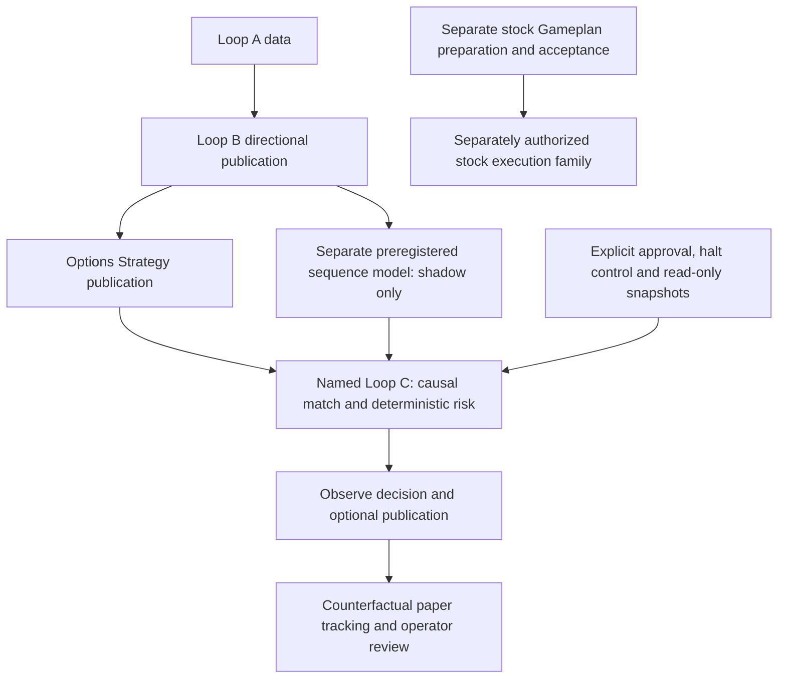

# Loop C: shared observe-only design

**Named Loop C is a shared, non-production, observe-only research component.** The implementation is `ml.loop_c`: it combines accepted Options Strategy candidates with a separately accepted pooled sequence shadow model, applies deterministic risk controls, and records research decisions. It has no order-submission path in its observer decision runtime. A research proposal, counterfactual paper outcome or favorable rollout review cannot activate trading. [S1, S2, S6]

This chapter describes source checked on **October 10, 2026, Pacific time**, at Ducketz commit `9c5b50281169f05032bb0d6d943f761447e70cab`. The cited common implementation files were unchanged from Atlas's earlier cited commit `90704d21801f60426493bd6cc650a7fac38d4f61`. Source design does not establish installation, a configured schedule, a running process or an accepted local publication. Read the [Scout companion](scout/loop-c.md) and [Atlas's dated chapter](atlas/loop-c.md) for separately attributed evidence.

## Boundary and dependencies

Arrows describe source relationships, not completed runs. There is no observer-proposal-to-stock-order edge in the inspected decision path. Pricing and option-outcome evidence support the upstream Strategy/sequence and downstream paper stages; the observer does not train models or fetch quotes. Stats and stock Gameplan are not direct inputs to the named observer. [S1, S3, S5]

Observe-only does **not** mean symbol-agnostic. The observer inherits symbols from Strategy candidates and matches sequence routes for those symbols. Sequence preregistration freezes its own symbols, source Loop B generation, information cutoff and configuration. Risk evaluation uses candidate-specific symbol exposure. Neither PC's watchlist proves that an accepted observer cohort covers its local research or stock execution universe. [S1–S3]

The separate `ml.gameplan_stock_trader` / `ml.stock_trader` family has execution entry points, enable gates, broker interactions and durable order/ledger responsibilities. Its stock plans, task ownership, acknowledgements, fills and reconciliation are not Loop C outcomes. Atlas's [stock execution findings](atlas/loop-c.md#current-stock-execution-family) remain Atlas-attributed, dated evidence; this shared chapter grants no execution authority to either PC. [S7]

## One observer pass

The CLI requires a decision timestamp and four explicit input files. It has no internal hourly scheduler, missed-wake catch-up or general saved-stage resume loop. Any scheduled owner requires independent machine evidence. The stage order is: [S1]

1. **Validate explicit inputs.** Approval must have the exact schema, `APPROVED` observe-only scope, model binding, operator identity/rationale, finite typed limits and an unexpired chronological lease. The independent halt control must be well formed and current. Portfolio and broker snapshots must meet read-only/reconciled, freshness, source-policy and confined source-receipt requirements. Input validation alone returns `READY_INPUTS`; it is neither a decision nor a publication. [S2]
2. **Acquire the observer lock and read accepted publications.** Strategy supplies candidate identity, legs, costs, loss/capital, calibrated profit probability, net delta and target windows. Sequence supplies shadow distributions under the exact approved model, policy, configuration fingerprint, schema, consumer and horizon binding. Both use publication readers, not loose unverified prediction files. [S1, S3]
3. **Align causal routes and eligible exits.** Match symbol, horizon and decision timestamp; the one-hour route also matches target-window start. Sequence distributions reject duplicate/null routes, automated-action flags and future information. A sequence publication unavailable at the consumer cutoff is rejected and later predictions excluded. Partial shadow coverage is reported; unmatched routes do not become forecasts. The model binding includes `1h`, `4h`, `1d`, `1w`, but option-paper proposals require bounded exact-leg exits on `1d` or `1w`. Calendar targets and expiry coverage matter; a week is not always five sessions. [S1, S3, S5]
4. **Evaluate deterministic risk in OBSERVE mode.** Check the XNYS regular-session gate, model age, controls, portfolio/broker state and candidate capacity. An eligible candidate can become a research proposal, never a reservation or order. Halt, no-trade and review decisions remain meaningful research outcomes. [S1, S2]
5. **Write the run and optionally publish.** Write `decisions.parquet`, `report.json` and a manifest with source lineage and safety fields. Publication is explicit; a run directory alone does not establish an accepted current publication. Paper tracking and weekly review are separate consumers. [S1, S4–S6]

Loop A and Loop B are indirect lineage. The observer does not itself enforce the production Loop B entry point's current complete-Loop-A-cycle gate. Its accepted upstream publications and causal checks cannot be described as a fresh end-to-end data readiness check. [S1, S3, S8]

## Risk and operator responsibilities

Global gates cover halt, session closure, model age, reconciled/fresh snapshots, daily loss, gross exposure, position/order counts and uncertain submission state. Halt or the daily-loss limit produces HALT. Other blockers can produce no-trade or review. Research-only reason codes do not provide execution permission, even though the policy enum also names other modes. [S2]

Candidate gates check horizon-specific Strategy probability, sequence support in the candidate's net-delta direction, return on risk, uncertainty and positive finite loss/capital. Effectively neutral structures have no directional veto. Proposed whole-unit quantity is bounded by per-trade loss, cash, gross and symbol capacity, and the approved cap. Positive uncertainty-adjusted utility wins with a deterministic identity tie-break. These are modeled limits and quantities, not changes to real inventory. [S2]

The risk-proposal helper emits **pending** limits. Explicit operator issuance verifies that proposal and model binding, requires identity/rationale and halt state, archives issuance evidence, and installs time-bounded controls under a lock; the implemented lease ends Friday at 17:00 Pacific. An expired approval is not renewed by weekly review. Rollout evaluation always leaves automatic promotion and authority expansion disabled. This describes responsibilities; documentation review neither issues controls nor changes thresholds. [S2, S6]

The observer consumes already captured snapshots. Separate snapshot tooling and the weekly review's optional account-capture route can make read-only broker calls; observe-only is not a promise that every helper is offline. No helper or production workflow was invoked for this curation. Reports and the input helper's `public_summary` can contain account information despite that label, so they are not publication-safe documentation exports. [S2, S6]

## Outputs, publication and evidence limits

| Evidence | Meaning and limit |
| --- | --- |
| Observer run | Timestamped decision/report/manifest. Runtime and publication safety require `OBSERVE_ONLY`, disabled orders and zero orders placed. Validation or partial output is not accepted publication. [S1, S4] |
| Published observer | A confined run, checked manifest outputs, checksummed receipt and atomic current pointer. Reader agreement establishes the recorded publication chain, not current account truth or future freshness. [S4] |
| Paper ledger | Reconstructs the frozen exact Strategy proposal, deduplicates identical identities and rejects conflicting duplicates. The decision timestamp is part of identity. Pending target, pending mature evidence and mature receipt-matched outcomes are distinct; missing exit evidence stays pending. Exercise/assignment modeling does not create inventory. [S5] |
| Weekly/rollout review | Monitoring, evidence sufficiency and pending proposals for operator review. Separate account context is not Loop C-attributed performance. No self-approval, control renewal, retraining or automatic trading promotion follows. [S6] |

Invalid, missing, corrupt, future, expired or incompatible evidence can stop the CLI with `ERROR` and exit 2 before any decision is written. A closed market produces a blocked/no-trade result only after inputs can be loaded. A later failure does not refresh an older retained pointer. The observer provides neither broker reconciliation nor a general retry/recovery system. [S1–S4]

Manifest verification checks listed output sizes/hashes; it does not replay all historical inputs. Snapshot receipt validation is not a fresh broker query or external attestation. Model age is checked explicitly, but the observer entry has no separate current-Strategy-age gate beyond inherited publication/route contracts. Saved source, configured tasks, process presence, accepted decisions and downstream outcomes must therefore be reported separately. [S1–S4]

Only reviewed, sanitized documentation belongs in this repository. Exact local symbols, native IDs, absolute operational paths, bindings and receipts stay in private machine evidence, along with account state, financial packets, task memory, raw data, databases, fitted models and credentials. A successful key scan does not replace a substantive review of the text. Documentation PR publication is separate from main integration, machine installation and runtime deployment. See the [coordination rules](../coordination/README.md).

## Provenance and preserved history

At the curation base `7fd33541efc8bc47013c13c330578ae0f1a8ec4e`, both machine chapters were byte-identical copies of the Atlas narrative introduced in [the earlier documentation commit](https://github.com/jeremysecondstate/atlas-scout/commit/8d7b85e8f55eed0f8c4d29211bfb09ca1d9e084b). The Scout path was not independent Scout evidence. Its companion now records that correction and only bounded local observations.

Atlas's chapter remains unchanged because its original content and index addition are still owned by [Atlas PR #11](https://github.com/jeremysecondstate/atlas-scout/pull/11). Its evidence keys, October 10 task/runtime observations, older paper/review history, stock findings and unresolved limits remain together. Structural duplication remains in its opening definition/diagram and common input, risk, publication and paper explanations, principally **“What ‘Loop C’ means here”** and **“Named Loop C: inputs, stage order and outputs.”** Use this shared chapter for common design; retaining that overlap avoids rewriting the pending Atlas publication. No Atlas claim was converted into Scout evidence or refreshed by this curation.

Historical rollout clocks and handoff terminology remain design history, not proof of a current scheduler. Absence in a scoped local inspection is not proof of absence on either PC. Atlas's evidence index records what Atlas checked; the [Scout evidence index](scout/loop-c.md#evidence-and-limits) records this curation's narrower local inspection.

## Source and evidence index

References below pin the inspected common design. They support source claims only; exact private evidence hashes and review receipts are retained locally.

| Key | Source and scope |
| --- | --- |
| S1 | [Observer runtime](https://github.com/jeremysecondstate/ducketz/blob/9c5b50281169f05032bb0d6d943f761447e70cab/ml/loop_c/runtime.py): inputs, route join, stage order, outputs, session and CLI boundary. |
| S2 | [Inputs](https://github.com/jeremysecondstate/ducketz/blob/9c5b50281169f05032bb0d6d943f761447e70cab/ml/loop_c/inputs.py), [policy](https://github.com/jeremysecondstate/ducketz/blob/9c5b50281169f05032bb0d6d943f761447e70cab/ml/loop_c/policy.py), [engine](https://github.com/jeremysecondstate/ducketz/blob/9c5b50281169f05032bb0d6d943f761447e70cab/ml/loop_c/engine.py), [operator controls](https://github.com/jeremysecondstate/ducketz/blob/9c5b50281169f05032bb0d6d943f761447e70cab/ml/loop_c/operator_controls.py) and [pending risk proposal](https://github.com/jeremysecondstate/ducketz/blob/9c5b50281169f05032bb0d6d943f761447e70cab/ml/loop_c/risk_proposal.py). |
| S3 | [Sequence consumer](https://github.com/jeremysecondstate/ducketz/blob/9c5b50281169f05032bb0d6d943f761447e70cab/ml/sequence_encoder/consumer.py), [preregistration/runtime](https://github.com/jeremysecondstate/ducketz/blob/9c5b50281169f05032bb0d6d943f761447e70cab/ml/sequence_encoder/runtime.py), [sequence publication](https://github.com/jeremysecondstate/ducketz/blob/9c5b50281169f05032bb0d6d943f761447e70cab/ml/sequence_encoder/publication.py) and [Strategy publication](https://github.com/jeremysecondstate/ducketz/blob/9c5b50281169f05032bb0d6d943f761447e70cab/ml/strategy_publication.py). |
| S4 | [Observer publication](https://github.com/jeremysecondstate/ducketz/blob/9c5b50281169f05032bb0d6d943f761447e70cab/ml/loop_c/publication.py) and [artifact verification](https://github.com/jeremysecondstate/ducketz/blob/9c5b50281169f05032bb0d6d943f761447e70cab/ml/artifacts.py). |
| S5 | [Paper ledger and tracking](https://github.com/jeremysecondstate/ducketz/blob/9c5b50281169f05032bb0d6d943f761447e70cab/ml/loop_c/paper_ledger.py). |
| S6 | [Weekly review](https://github.com/jeremysecondstate/ducketz/blob/9c5b50281169f05032bb0d6d943f761447e70cab/ml/loop_c/weekly_review.py), [rollout evaluator](https://github.com/jeremysecondstate/ducketz/blob/9c5b50281169f05032bb0d6d943f761447e70cab/ml/loop_c/rollout.py) and [read-only snapshot helper](https://github.com/jeremysecondstate/ducketz/blob/9c5b50281169f05032bb0d6d943f761447e70cab/ml/loop_c/schwab_snapshot.py). |
| S7 | [Separate stock entry](https://github.com/jeremysecondstate/ducketz/blob/9c5b50281169f05032bb0d6d943f761447e70cab/ml/gameplan_stock_trader.py); [Atlas's dated source/runtime evidence index](atlas/loop-c.md#source-and-native-evidence-index) also distinguishes its locally modified stock sources. |
| S8 | [Loop B prediction entry](https://github.com/jeremysecondstate/ducketz/blob/9c5b50281169f05032bb0d6d943f761447e70cab/ml/prediction_runtime.py) and [historical Loop C rollout design](https://github.com/jeremysecondstate/ducketz/blob/9c5b50281169f05032bb0d6d943f761447e70cab/docs/loops-system-analysis/LOOP_C_ROLLOUT_PLAN.md). |
