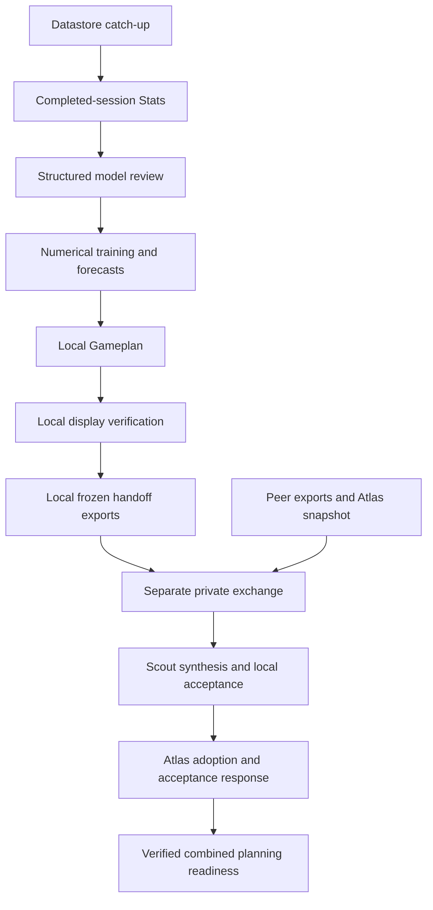

# Nightly workflow and recovery

**Status: reviewed shared implementation reference, October 11, 2026.** Atlas owns this chapter. Source was captured at **00:34:11 PDT / 07:34:11 UTC** and inspected without running application code. This describes the implementation present in Atlas's working checkout, not proof that both PCs run identical bytes. See [Atlas's companion](atlas/nightly-workflow.md) and [Scout's reviewed companion](https://github.com/jeremysecondstate/atlas-scout/blob/8b1ef9d547adbaa8ece26de585ce0ef126c70215/system-details/scout/nightly-workflow.md) for separately attributed observations.

## Purpose and boundary

The workflow connects completed market data, saved forecast evaluation, model review, numerical training/prediction, planning and display/export checks. Local preparation and cross-PC exchange are separate state machines. Finishing local preparation does not establish combined planning, peer acceptance or execution. Planning readiness does not authorize a trader or establish orders, fills or reconciliation. [W1, W4, W5]

The current responsibility layout contains seven ordered steps. Source also reads older five-step runs; historical completion retains its original layout. Native schedules belong in the machine companions. Similar wake times do not make numerical dependencies simultaneous. [W1, W2]

The diagram identifies dependencies, not a schedule or a completed run. The numerical/planning contracts are in [Stats and feedback](stats-and-feedback.md) and [Gameplan](gameplan.md). [W1, W4]

## Entry points and stages

`tools.nightly_watchdog` is a bounded native wake adapter. It invokes `ml.nightly_workflow --dispatch`; the dispatcher selects one eligible responsibility and may launch its existing worker. The adapter does not fetch, fit models or transport financial packets itself. `--launch` returns a PID/log and `LAUNCHED`, not completion. Scheduled supervisors inspect the same durable state. These entry points were read, not invoked. [W1, W2]

| Step / logical owner | Work and output | Completion boundary |
| --- | --- | --- |
| `datastore_catchup` / datastore | Bounded Loop A close fetch and configured stock-target history | Archive path stops after stock-target history; alternative supported price path stops after close fetch. Native receipt/report/log hashes must agree. |
| `prepare_stats` / Stats | Native `gameplan_stats` for the completed source session | Evaluates eligible saved forecasts/planning prices; no eligible history is explicit, not a fabricated score. |
| `model_review` / model | Structured inference over frozen diagnostics | Saves a bounded proposal or `KEEP_CURRENT`; does not itself fit/promote. |
| `train_and_plan` / model | Native segment from Loop B generation through stock enrichment training in the split layout | Uses exact feedback and saves the accepted forecast pin. Its retained name does not imply later local planning completed. |
| `local_gameplan` / Gameplan | Native segment beginning at `gameplan_trade_planning` | Consumes the preceding forecast receipt; actor configuration selects account-aware or research-producer planning. |
| `verify_display` / display | Local plan/source/Stats readers against exact saved runs | Checks dates, scope, source receipt and applicable planning availability before combined synthesis exists. |
| `local_handoff` / display | Owner plan and Stats exports from those verified runs | Saves byte hashes; delivery is held for the separate exchange. |

Table: W1 `workflow_steps`, `_run_native`, `_execute_step`, `_display`, `_research_display`, `_handoff`. Preparation's required `peer_communication_enabled=false` does not disable the separately authorized private exchange. [W1, W4]

## Calendars and information boundaries

The intended session is the newest completed XNYS exchange session whose **17:00 Pacific action-day boundary** has passed; its next exchange session is the action date. Kickoff is 21:05 on the source session, original deadline 04:00 on the action date. Exchange holidays/weekends and timezone-aware Pacific clocks govern selection. The 17:00 boundary is distinct from the regular exchange close. Friday preparation can target Monday without a new weekend market session. [W2, W3]

The ordinary scheduled path can return a non-session no-op. Deterministic catch-up selects the intended dated work and retains terminal results. A missing intended run is `NOT_STARTED`; an older latest success is not a substitute. Closed-market prices may be appropriate completed-session evidence, but each consumer applies its own coverage, receipt and cutoff checks. Future wakes/provider availability are not established here. [W1–W3]

Missed-night recovery preserves the action date and original deadline, adding a frozen expiry no more than seven hours after authorization and no later than 17:00 on that action session. Automatic recovery needs recorded local human authority; explicit catch-up has its own evidence schema. Retries do not renew expiry. The late stock-only route records real publication times and retains pre-opening training information boundaries; it cannot backdate an ordinary publication. [W1–W3, W6]

Planning-tail continuation is a distinct, separately authorized exception for an existing failed/stopped tail with prior stages complete. It binds original source, failed native receipt, workflow identity and both original deadlines. A reviewed repair chain may bridge source identity; installation alone grants no extension. Earlier training is not reopened by this exception. [W1, W6]

## Ownership, duplicates and restart behavior

The adapter has a wake lock, preparation a workflow lock, and numerical work the datastore overnight runtime lock plus renewable supervision lease. Lease loss records failure and requests a stop only for its owned stage. Unchanged observer events are deduplicated using stable decision/failure fields rather than volatile timestamps or PIDs. [W1, W2, W6]

Before work, the coordinator binds profile/watchlist, configuration, sessions and source identity. Its application digest covers Python files under `ml`, `datafetching` and `app`, not every shell tool, task definition or configuration. Selected configuration and outputs have separate bindings. Git HEAD alone cannot establish the working bytes used. [W1]

The native attempt identity is saved before stage execution; report/log/output hashes are verified before step completion. Restart can reuse a complete native receipt or exact saved structured-review answer. An unfinished attempt needs implemented interrupted-run recovery. Native ownership checks include process identity/creation time: process exit, reused PID or a stale-looking lock file alone does not authorize takeover. These are source capabilities, not a recovery test performed here. [W1, W6]

Unfinished work rejects changed source, configuration, scope or completed outputs. Terminal preparation retains its original results and can attest historical feedback against frozen Stats/policy hashes; that attestation never feeds new training. Corrupt terminal evidence still fails verification. A later installation does not turn old completion into success under today's source. [W1, W4]

## Failures and bounded repair

Failures are classified as transient, external dependency or source defect. Transient retry uses five-minute backoff and a configured maximum of one to three attempts, preserving cumulative counts and audited retry epochs. Authentication, tool availability and usage-limit failures retain dependency evidence. An unchanged deterministic defect requires repair rather than repeated retries. Errors retain stage, owner, fingerprint, source identity and private diagnostic tails. [W2]

Preparation and exchange share a persistent repository repair owner. Process death or elapsed time does not authorize takeover. Reviewed repairs bind originals, explicit changed paths, downstream invalidation and model-review impacts. The matching domain verifies resumed results before releasing the exact claim. Same-owner continuation retains ancestry and is bounded to three repair attempts. No repair was installed or executed in this inspection. [W6]

Missing exchange prerequisites produce durable `PENDING`. Lock contention is ordinary liveness, not automatically a failure. Arrival of a packet is separate from verified dates, producer ownership, references and acceptance hashes. Terminal exchange verifies retained local packets, dated plan/Stats and readiness receipts without replaying preparation or synthesis. Later live peer unavailability does not erase completed history, while corrupt saved evidence still fails closed. [W4, W5]

## Outputs, consumers and completion evidence

| Record | Meaning | Insufficient alone to establish |
| --- | --- | --- |
| Scheduler result / watchdog decision | Registered wake or dispatcher invocation/disposition | Numerical completion or accepted publication |
| Workflow step `COMPLETE` | Saved step output identity and verified recorded hashes | Remaining local or peer stages |
| `LOCAL_COMPLETE_PEER_SETUP_PENDING` | Local preparation/export completion; retained historical wording | Current absence of peer setup, combined readiness or execution |
| Synthesis `JOINT_READY_LOCAL` | Combined plan/Stats and local reader checks at that layer | Later peer acceptance response |
| Atlas handoff / dated readiness receipt | Exact local adoption and matching selections | Current worker liveness or rendered pixels |
| Exchange `COMPLETE` with joint/UI/peer verification | Saved cross-PC planning completion with acceptance evidence | Execution authorization, submission, acknowledgement, fills or reconciliation |

Table: W1, W4–W5. Downstream consumers include Gameplan/Stats readers and the separately controlled trader. Readiness notifications have their own dated deduplication records. A dashboard label or saved `FINAL_VERIFIED` supervision state is not independent proof of every stage. [W4, W5]

## Evidence index, history and limits

Source below was frozen **October 11, 00:34:11 PDT** in Atlas's private evidence. Ducketz HEAD was `90704d21801f60426493bd6cc650a7fac38d4f61`, with existing local changes. Exact hashes remain private; a commit link would not identify untracked modules. No process is claimed to have loaded these current bytes.

| Ref | Application paths and entry points | Source layer |
| --- | --- | --- |
| W1 | `ml/nightly_workflow.py`: `workflow_steps`, `source_identity`, `_run_native`, `run_reviewer`, `_display`, `_completed_feedback`, `_verify_local_preparation`, `_handoff`, `run_workflow`, `status`, `dispatch_status`, `main` | Untracked working source at recorded HEAD |
| W2 | `ml/nightly_dispatch.py`: owners, `intended_session`, `failure_record`, `retry_disposition`; `tools/nightly_watchdog.py`: `run_once` | Untracked working source |
| W3 | `ml/gameplan_actuals_review.py`: `completed_session_context`; `ml/nightly_recovery.py`: session/recovery selection and validation | Modified actuals review; untracked recovery |
| W4 | `tools/nightly_exchange.py`: `_run`, `_verify_acceptance`, `_completed_result`, `_run_once`; `ml/nightly_synthesis.py`, `ml/nightly_handoff.py` | Untracked working source |
| W5 | `ml/nightly_joint_readiness.py`, `ml/nightly_readiness.py`, `tools/nightly_notifications.py` | Untracked working source |
| W6 | `ml/overnight_runtime.py`, `datafetching/runtime_lock.py`, `ml/preparation_deadline.py`; `ml/nightly_stage_repair.py`, `ml/nightly_exchange_repair.py`, `ml/nightly_repair_registry.py` | First three modified; repair modules untracked |

Older runbooks describe a monolithic overnight task and, in places, five-minute model-driven exchange supervision. Per-PC native readback decides current recurrence; the deterministic five-minute Windows dispatcher is a different responsibility. Scout's reviewed October 11 chapters establish Scout observations only. The prior scaffold contained no runtime findings and is replaced by this reference.

This inspection did not run semantic application validators, providers, models, recovery, synthesis, adoption, UI rendering or trader controls. Source behavior, retained-byte verification and production outcomes remain distinct. Full private packets, exact universes, native identifiers, bindings and receipts are excluded.

[System details index](README.md) · [Stats and feedback](stats-and-feedback.md) · [Gameplan](gameplan.md)
