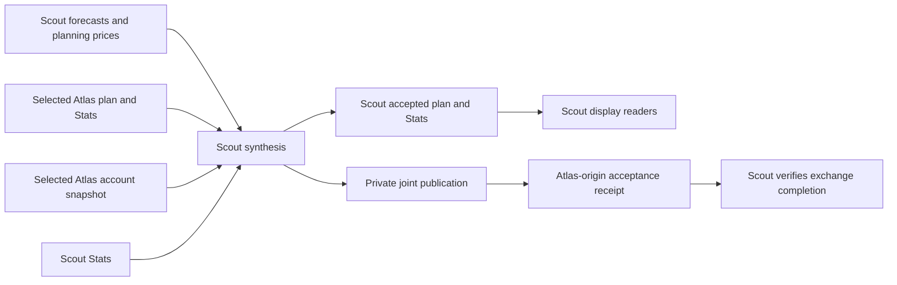

# Scout: Gameplan lifecycle

Scout's independently inspected evidence supports completed local preparation, combined planning and receipt-bound exchange for action date **2026-10-12**, using the completed **2026-10-09** Stats session. This is a saved planning outcome. It does not establish a running trader, execution permission or actual trading performance.

Read the [shared Gameplan explanation](../gameplan.md) for the common interface. Atlas owns that chapter; at this companion's publication base it is still a placeholder. This chapter records Scout's installed responsibilities and retained evidence without claiming to verify Atlas's current machine.

## Identity and observation scope

Scout identity and authority come from the local profile bound to the verified installed coordination release. Source and saved-file observations were captured **2026-10-11 00:06:35 PDT / 07:06:35 UTC**. Native task definitions were captured **00:02:36 PDT / 07:02:36 UTC**. The application checkout reports HEAD `9c5b50281169f05032bb0d6d943f761447e70cab` with local changes; current working bytes are not represented by that commit alone.

The independently calculated aggregate digest of the current `ml`, `datafetching` and `app` Python tree is `42fa58e6a243915df082464e651af93f26a9df2654c3231a88b48f3db203cb09`. It differs from the digest recorded by the completed preparation. Both selected owner packages explicitly mark their generation source revision **UNRECORDED**. Exact artifact checksums still bind their contents; neither today's checkout HEAD nor an artifact digest supplies the missing generation revision.

The private dated report retains full bindings, native identities, packet references, source inventories and evidence copies. The installed coordination manifest and its 29 listed files matched; a stricter installation check found pre-existing extra bytecode/cache files. This documentation task made no installation changes.

## Scout responsibilities and inputs

Scout prepares its own research partition, produces local plan and Stats exports, and composes both producers' forecasts against the single account snapshot supplied by Atlas. Scout has no live execution authority. The coordination agreement assigns Atlas the account snapshot and adoption of Scout's exact synthesis; that agreement is a responsibility statement, not proof of Atlas's installed schedule.

The current saved preparation is stock-only, uses `independent-stock-targets-v1`, archive prior-session features and `xnas-itch-archive-v1` target prices, and labels probability as `raw-price-direction-v1`. Its receipt records a Loop B publication as input and **no strategy publication**. The stock-only source path reads Loop B samples and requires its predictions file, then builds independent Gameplan targets; this does not mean it simply copies Loop B probabilities. The historical monolithic options/strategy path is not this run's upstream chain.

| Input inspected on Scout | Binding and applicability | Boundary |
| --- | --- | --- |
| Local forecast publication | Immutable manifest/receipt, local frozen universe, action date and independent stock target/probability contracts | Direction and probability are frozen research outputs. |
| Local planning-price publication | Exact forecast receipt, completed producer-only trade-plan receipt and declared price-source contract | Latest mode is `RESEARCH_PRODUCER_SOURCE`; Scout's preparation is not an account snapshot producer. |
| Both owner packages | Explicit producer/digest, disjoint universes, action date, 24 original slots per symbol, compatible price/fallback policies | Both latest packages retain 264 rows. Coverage is distinct from positions. |
| Both Stats packages | Producer, completed review session, universe, byte digest and probability-target compatibility | Review time cannot be later than synthesis. |
| Atlas account snapshot | Exact file, account scope and clock linked to the selected preparation pair | It was about 157 seconds old at saved synthesis, within the 900-second default. This is historical freshness. |

For the archive route, the reader admits completed intervals only after its processing delay and validates declared source coverage. The alternative operational prior-session selector uses the immediately following XNAS/XNYS session, a completed hourly source ending no earlier than regular close, and the earlier of run time and source-session 17:05 Pacific cutoff. These are distinct contracts; the saved run declares the archive contract. Daily data and carried planning prices do not silently replace observed intraday target endpoints.

## Preparation, synthesis and adoption

Completed local worker outputs feed the separate exchange responsibility. The exchange binds the profile, operating configuration and source adapter bytes, and checks recorded export hashes. Routine GitHub coordination and private financial exchange remain separate paths.

Synthesis requires exactly the independently selected Atlas and Scout packages and Atlas snapshot. Current source rejects wrong producers, dates, universes, overlapping ownership, future/stale inputs, incompatible planning-price policies and duplicate forecasts. The default package and planning-price age bound is seven days; this is package admissibility, not live quote freshness. Selected files are checked again after reading.

Scout first installs both outputs in an isolated candidate and checks the default Gameplan/Stats readers. It then adopts the exact plan and combined Stats locally, verifies the readers and records readiness. A failure between the two adoptions leaves `PARTIAL_ADOPTION`; retry uses the same completion identity and exact specification. A changed specification or different accepted plan for the same date fails rather than replacing a potentially consumed plan.

Accepted planning contains frozen identities, direction, allocation horizons, eligibility and holding windows, with account-aware quantities and cash projections. Events use conditional planning fills. It reserves no live capital and authorizes no orders. Estimated prices and projected sale proceeds remain distinct from current broker quotes, actual fills and available cash.

The Gameplan display selects a verified accepted combined plan when applicable; an invalid accepted/account publication fails closed. The trader consumer validates saved directions, probabilities, abstentions and windows, and checks the execution-owner binding. On Scout that check excludes execution. Atlas trading still depends on its existing operator controls and live reconciliation; acceptance does not start the trader. Forecast accuracy, hypothetical plan results and actual trading performance require separate evidence.

## Installed task relationships

Saved native configuration at **2026-10-11 00:02:36 PDT** follows. The local profile uses `America/Los_Angeles`; native recurrence records do not embed a separate timezone field. A recurrence establishes scheduling, not successful launch or numerical completion.

| Responsibility | State and local recurrence | Model / effort | Gameplan relationship |
| --- | --- | --- | --- |
| Deterministic dispatcher | Enabled, Ready; last result 0 | None | Starts/resumes dependency-ready stages through `ml/nightly_dispatch.py`; its exit code alone does not prove stage completion. |
| Gameplan | ACTIVE, daily 21:05 | GPT-6 Luna / low | Owns the Gameplan responsibility through the dispatcher and saved stages. |
| Gameplan Stats | ACTIVE, daily 21:05 | GPT-6 Luna / low | Supplies reviewed prior-session Stats; see [Scout Stats](stats-and-feedback.md). |
| Synthesis, evening | ACTIVE, Monday–Friday every 20 minutes, 21:00–23:40 | GPT-6 Astra / ultra | Bounded private exchange and synthesis after preparation. |
| Synthesis, after midnight | ACTIVE, Tuesday–Saturday 00:00, 00:20, 00:40 | GPT-6 Astra / ultra | Continues the same exchange responsibility. |
| Display/readiness | ACTIVE, daily 03:00 and 03:35 | GPT-6 Luna / low | Verifies accepted downstream readiness; warning clocks do not prove acceptance. |
| Historical overnight monolith and weekly review | PAUSED | Retained native definitions | Historical identities/memory are preserved; old prompts do not define the current graph. |

Dispatcher timing, model review and recovery limits are in [Scout nightly workflow](nightly-workflow.md) and [scheduled tasks](scheduled-tasks.md). This inspection invoked no task, numerical worker, provider, broker, training or prediction path.

## Saved outcomes and acceptance

| Evidence level for action date 2026-10-12 | Saved finding | Meaning and limit |
| --- | --- | --- |
| Scheduling / launch / liveness | Native definitions inspected; saved numerical stages completed | Current configuration and historical completion differ. No claim that a worker/trader is currently alive. |
| Component completion | All seven stages COMPLETE; final local timestamp **October 9 22:28:28 PDT / October 10 05:28:28 UTC** | Saved output hashes still match. Terminal `LOCAL_COMPLETE_PEER_SETUP_PENDING` describes local preparation, not exchange completion. |
| Accepted local synthesis | `JOINT_READY_LOCAL`, accepted **October 10 03:24:46 PDT / 10:24:46 UTC** | Selected plan, combined Stats and five UI-evidence files match readiness bindings. This receipt retains `peer_verified=false`. |
| Exchange acceptance | Later status `COMPLETE`, `peer_verified=true` | Retained Atlas-origin `HANDOFF_VERIFIED_LOCAL` binds Scout's receipt, exact plan bytes and selected plan/Stats packages. |
| Downstream readiness | Local readiness selection and accepted pointers match synthesis; saved supervision records `FINAL_VERIFIED` at **October 10 08:59:10 PDT / 15:59:10 UTC** | Supports historical planning/display handoff. It is not current UI process, execution, order/fill or performance evidence. |

Atlas's receipt was **observed from Scout's retained cache on October 11 at 07:06:35 UTC**. Neither receipt nor packet contains an explicit acceptance/observation timestamp. The producer is Atlas; its exact producer-side observation time is unavailable. Filesystem modification time cannot supply it. This inspection verified retained bindings, not Atlas's current files, scheduler or processes.

Older readiness warnings and preserved failure/repair records do not override the later selected completion. The exchange retains a coordination-only binding transition, explaining continuation of the same completed preparation through reviewed binding changes. Current source drift does not erase a consistent terminal outcome or prove that today's bytes generated it.

## Failure and recovery limits

Missing preparation or fresh account evidence is pending. Conflicting immutable selections, wrong scope, changed artifacts, incompatible policy or changed retry specifications fail validation and require review. Synthesis and adoption use distinct locks; partial adoption is preserved and date selections are immutable. An explicitly allowed new Atlas snapshot can refresh stale evidence before selection; an accepted joint plan freezes its snapshot.

Terminal exchange readback checks retained local evidence without replaying preparation, capture or adoption after source/availability changes. This task preserved the state and repair history and exercised no recovery, active reconciliation or execution.

## Evidence and review

The [Ducketz reference revision](https://github.com/jeremysecondstate/ducketz/tree/9c5b50281169f05032bb0d6d943f761447e70cab) is a navigation starting point. The private working-byte inventory is authoritative for this inspection because several files differ from that revision.

| Inspected source | Interface |
| --- | --- |
| `ml/nightly_gameplan.py`, `ml/gameplan_source_selection.py`, `ml/gameplan_archive_features.py` | Preparation, prior-session selection and archive availability/coverage |
| `ml/joint_capital_handoff.py`, `ml/joint_capital_plan.py` | Export provenance, `compose_joint_plan`, freshness and planning authority |
| `tools/nightly_exchange.py` | `_run`, `_verify_acceptance`, `_completed_result` |
| `ml/nightly_synthesis.py`, `ml/nightly_handoff.py` | Candidate validation, adoption and exact Scout-to-Atlas handoff |
| `ml/joint_capital_adoption.py`, `ml/nightly_joint_readiness.py` | Date acceptance, execution-owner assertion and selected readiness |
| `app/ui/gameplan_data.py`, `ml/stock_trader/gameplan_execution.py` | Display selection and saved-instruction consumers |
| `ml/nightly_workflow.py`, `ml/nightly_dispatch.py` | Source identity, dependencies and preparation boundary |

Standard-library read-only checks passed **67 artifact/binding comparisons**. A separate **427-file stability check** passed after a documentation evidence-scope correction and the additional supervision read at **07:12:05 UTC**; relevant task definitions were unchanged. The saved/current source comparison records a mismatch as a provenance limit. No application validator or operational workflow was executed; these checks establish byte consistency and inspected bindings, not rerun numerical correctness or current UI behavior.

Shared bytes were reviewed to exclude exact symbol membership, native IDs, absolute operating paths, private receipt identities, credentials, balances, positions, orders/fills, financial packets, raw datasets and fitted models. Dated historical findings remain useful without exporting their private originals.

## Related references

- [Scout scheduled tasks](scheduled-tasks.md)
- [Scout Stats](stats-and-feedback.md)
- [Scout nightly workflow](nightly-workflow.md)
- [System details index](../README.md)
