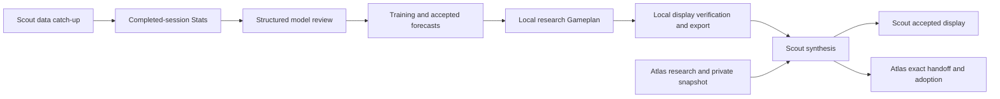

# Scout: nightly workflow, saved outcomes and recovery

Scout independently inspected the local configuration, saved native task definitions, read-only scheduler rows, Windows registrations and retained workflow evidence on **October 11, 2026, 00:02–00:07 PDT (07:02–07:07 UTC)**. This is the Scout companion to the [shared nightly explanation](../nightly-workflow.md). That shared chapter is Atlas-owned and remained a placeholder at this companion's publication base; Scout's observations are complete within the limits below.

Identity comes from Scout's private local profile and pinned coordination release, not the signed-in account or a copied chapter. The pinned manifest and its 29 listed files matched. A stricter installation inventory reported pre-existing extra Python cache files; this documentation task preserved them and did not claim a wholly clean strict installation. Application HEAD was `9c5b50281169f05032bb0d6d943f761447e70cab`, with other writers' working changes. Exact inspected source and evidence hashes are retained privately; HEAD alone does not describe those bytes.

## Scout's responsibilities and interfaces

Scout prepares its own research inputs and owns numerical synthesis of the two research packages against Atlas's one private account snapshot. Atlas supplies its own package and account evidence, then verifies and adopts the exact returned combined Gameplan, Stats and receipt. Atlas owns execution; the human controls trader start and stop. No Scout responsibility or dispatcher acquires execution authority from a successful planning receipt.

The local workflow has seven recorded steps in `nightly-responsibilities-v1`: `datastore_catchup`, `prepare_stats`, `model_review`, `train_and_plan`, `local_gameplan`, `verify_display`, and `local_handoff`. The deterministic coordinator selects the next eligible responsibility after its predecessor completes. Native daily checkpoints supervise these responsibilities; their matching clock times do not mean every numerical stage starts together.

The installed configuration selects archive-backed stock prices and archive-history preparation. Scout's native training and planning segments use the research-producer route. Preparation freezes the local symbol binding, source identity, price/history settings, probability target and reviewer configuration. The configured structured reviewer is **`gpt-6-astra` / high**, with a 30-minute ceiling further bounded by the workflow deadline. That differs from the **`gpt-6-luna` / low** native supervisor. The reviewer consumes saved diagnostics and proposes bounded changes; accepted model gates remain separate from the proposal. See [Scout Stats](stats-and-feedback.md) and [Scout Gameplan](gameplan.md) for their independently inspected artifacts.

`peer_communication_enabled=false` in the preparation configuration is intentional: preparation creates the local export; the separate private exchange transports and synthesizes it. It does not mean cross-PC exchange is disabled. Consumers are local display readers, the private exchange, combined Stats/Gameplan readers, and Atlas's separately controlled execution consumer. Exact symbols, paths, account scope, native IDs, packet selections and receipts stay in private evidence.

## Timestamped installed task relationships

The table reflects saved TOMLs and native scheduler rows read at **2026-10-11T07:02:36Z**. All times are America/Los_Angeles. Status, recurrence, model and reasoning agree between the two readbacks. Thirteen Ducketz definitions were present: nine active and four paused; the unrelated non-Ducketz automation was excluded. These are configuration observations, not success receipts.

| Logical responsibility / native display name | State and nominal recurrence | Native model / effort | Dependency and entry point |
| --- | --- | --- | --- |
| Scout DATASTORE CATCH-UP | Active; daily 21:05 and 04:05 fallback | `gpt-6-luna` / low | Coordinates catch-up through `ml.nightly_workflow`; the dispatcher selects the intended action date |
| Scout GAMEPLAN STATS | Active; daily 21:05 | `gpt-6-luna` / low | `prepare_stats` follows catch-up and scores the completed review session |
| Scout MODEL REVIEW, TRAINING & PREDICTING | Active; daily 21:05 | `gpt-6-luna` / low | `model_review` follows verified Stats; `train_and_plan` uses the exact saved review |
| Scout GAMEPLAN | Active; daily 21:05 | `gpt-6-luna` / low | `local_gameplan` follows accepted forecasts and retains their publication identity |
| Scout DUCKETZ DISPLAY | Active; daily 03:00 and 03:35 | `gpt-6-luna` / low | Verifies local display/export and later combined acceptance; owns dated readiness-risk and missed-confirmation notices |
| Scout GAMEPLAN SYNTHESIS | Active; Monday–Friday, every 20 minutes from 21:00 through 23:40 | `gpt-6-astra` / ultra | Private exchange waits for both packages and required Atlas snapshot, then synthesizes and follows exact acceptance |
| Scout GAMEPLAN SYNTHESIS after midnight | Active; Tuesday–Saturday, 00:00, 00:20 and 00:40 | `gpt-6-astra` / ultra | Continues the preceding evening's same logical synthesis responsibility |
| Scout REPO RECONCILIATION | Active; Monday–Friday, every 20 minutes from 21:00 through 23:40 | `gpt-6-astra` / ultra | Source coordination and owned failure resolution; ordinary cycle begins at first eligible evening wake |
| Scout REPO RECONCILIATION after midnight | Active; Tuesday–Saturday, 00:00, 00:20 and 00:40 | `gpt-6-astra` / ultra | Continues the same evening, owner, memory and durable claims |
| Loops Overnight Gameplan | Paused; retained daily 21:05 definition | `gpt-6-astra` / ultra | Historical monolithic launcher; not an additional active pipeline |
| Loops Gameplan Weekly Review | Paused; retained Saturday 09:00 definition | `gpt-5.6-luna` / medium | Historical separate forecast-evaluation responsibility |

The other two paused definitions are the retained Hyperliquid responsibilities. They are outside this nightly chain. No Scout Trader Rep definition was found. The two after-midnight companions preserve the logical owner while retaining their own actual native invocation identity privately.

Next-run readbacks differed from nominal daily checkpoint times: datastore was due October 11 at 04:09:56, model at 21:06:48, Stats at 21:02:14, and Gameplan at 21:01:49. Display was due at 03:00. Evening synthesis/reconciliation were due October 12 at 21:00; after-midnight companions were due October 13 at 00:00. A nominal recurrence is not a promise of second-exact launch. Neither the next-run row nor an earlier last-run row proves component completion.

Windows Task Scheduler was independently read at **2026-10-11T07:02:47Z**. The nightly dispatcher was enabled and Ready, with daily 21:05, five-minute and logon triggers, `StartWhenAvailable`, `IgnoreNew`, an interactive-user binding and a three-minute invocation limit. Its last recorded invocation was October 10 at 23:58:23 PDT, result zero, with zero recorded missed runs. It invokes the deterministic watchdog and existing coordinator. The separate completed-chat cleanup was also Ready, result zero; it is not a nightly numerical stage. Full native definitions and XML are private.

The three-minute Windows limit bounds a dispatcher invocation, not the overnight numerical worker. Windows dispatch can operate while the desktop app is closed, subject to its interactive-user and machine availability; native Codex supervision needs the app, and model review needs authenticated CLI access and usage availability. This inspection did not test those future prerequisites or infer liveness from registration.

## Calendars, deadlines and durable ownership

`completed_session_context` selects the newest XNYS session whose **17:00 Pacific action-day close** has passed, then its next exchange session as action date. `intended_session` uses 21:05 on that completed source session as kickoff and 04:00 on the action date as the original deadline. Exchange holidays, weekends and Pacific DST are resolved by the exchange calendar and timezone-aware timestamps. The action-day availability clock differs from the regular exchange close.

For the saved October 12 action date, the source/review session was Friday, October 9; kickoff was Friday 21:05 and the original deadline was Monday 04:00 PDT. Weekend watchdog wakes retained that completed action date. A morning readiness helper can also return a non-session no-op on a weekend; that does not contradict an already completed dated Monday preparation. The current twenty-minute synthesis/reconciliation windows have no launches at or after 01:00 and exclude Sunday evening. They do not terminate already active work, and display retains the 03:00/03:35 notification responsibility.

Single-writer boundaries include the watchdog wake lock, durable workflow lock, datastore native runtime lock and renewable supervision lease. The coordinator saves the native run identity before stage execution, then exact output hashes and completion state. It verifies frozen configuration, symbols, source and completed outputs before continuing unfinished work. A healthy worker is left running. Recovery checks process identity and creation time, so a reused PID is not treated as the old owner. Existing completed native receipts and saved structured-review responses can be reused after interruption; completion is not inferred merely from an exited process.

Scout's saved automatic-recovery policy is enabled with a three-attempt maximum. Source distinguishes transient failure, unavailable external dependency and source defect; transient failures have a five-minute cooldown and bounded attempt accounting. Repeated deterministic failures require a reviewed repair, while unavailable dependencies retain resumable evidence. Preparation and exchange share a persistent repair owner across dates; there is no timeout takeover. Reviewed source installation alone does not release the claim: the same unfinished stage must produce verified evidence.

Missed-night recovery keeps the exact action date and original deadline, freezes an additional expiry no more than seven hours away and no later than 17:00 on that action session, and cannot extend it on retry. Source-bound planning-tail continuation is a distinct, separately recorded exception for an existing late tail; it cannot rerun earlier training or replace the original deadlines. Terminal work stays terminal after a later source installation. No recovery, launch, repair, process control or operational workflow was invoked for this documentation.

## Saved outcomes and completion boundaries

The read-only audit copied dated state and compared retained output bytes with their saved hashes. It did not rerun providers, models, synthesis, adoption or the application readiness modules.

| Evidence level | Saved October 12 action-date observation | What it establishes |
| --- | --- | --- |
| Scheduling | Active definitions and future next-run rows above | Configured opportunities to supervise work |
| Launch / process liveness | Historical launches and scheduler exit zero; completed state has no active owner PID | Launch records are separate from live-process proof; no claim that every worker is currently healthy |
| Component completion | All seven split steps record `COMPLETE`, one attempt each; local completion October 10 at 05:28:28 UTC | Local preparation finished for October 12 using October 9 outcomes |
| Local publication | Frozen preparation status remains `LOCAL_COMPLETE_PEER_SETUP_PENDING` | Component-local completion; the legacy status text is not a current statement that peer setup is missing |
| Scout synthesis / local display | Pinned synthesis receipt records `JOINT_READY_LOCAL`, joint/UI readiness true, peer verification false | Exact local combined publication before the later acceptance stage |
| Cross-PC acceptance | Scout's retained exchange status records `COMPLETE`, joint/UI readiness and peer verification true; Atlas-origin acceptance is retained locally | Saved terminal exchange evidence, not a fresh inspection of Atlas's machine |
| Downstream / execution | Dated accepted publication files remain byte-identical | Saved planning readiness; no assertion of current trader liveness, execution authorization or actual trading results |

The October 9 recovered action-date run retains its earlier five-step layout and completed local preparation at **2026-10-09T19:21:51Z**. Its later exchange status also records completion and peer verification. This history is preserved; current seven-step ownership must not be retroactively assigned to that older run.

The independent stdlib audit verified **22 retained files for October 9 and 30 for October 12**, including recorded completed-step output references, local readiness receipt and combined UI evidence. All hashes matched at 07:07 UTC. This is an exact-byte retention check, not a fresh semantic execution of every application validator. The local cached Atlas acceptance is peer-produced evidence observed here at the inspection time; it does not establish Atlas's current schedules, installation, later changes or running trader.

Both saved workflow source identities differ from the inspected working source digest despite sharing the same Git HEAD. That is a material historical/current distinction. Current source explicitly allows retained terminal readiness to report `source_changed_after_completion`; unfinished runs require their reviewed source binding. The recorded successful outputs are not advertised as results of today's working bytes.

A separate old watchdog readiness file still says unconfirmed as of October 9. The newer terminal exchange and exact dated receipts supersede that observation for the saved October 12 outcome. The periodic watchdog record observed at 06:58 UTC retained completed local preparation without dispatch. It advanced during this audit with the same retained-terminal decision; mutable observation clocks were distinguished from stable source, task definitions, configuration and completed outputs.

## Sources, privacy and limits

Source references are in the Ducketz application repository: `ml/nightly_dispatch.py` (step ownership, session selection, retries), `ml/nightly_workflow.py` (frozen inputs, native segment boundaries, exact outputs and terminal handling), `ml/overnight_runtime.py` (calendar, runtime ownership and interrupted-worker recovery), `ml/gameplan_actuals_review.py` (completed-session clock), `ml/nightly_recovery.py`, `ml/nightly_stage_repair.py`, `ml/nightly_readiness.py`, `ml/nightly_joint_readiness.py`, `tools/nightly_watchdog.py`, `tools/nightly_exchange.py`, and `tools/nightly_notifications.py`. Their exact working hashes and the read-only audit are in Scout's dated private report. The existing runbooks explain design but do not prove installed state.

Older runbook text describing five-minute Codex synthesis/reconciliation is superseded on Scout by the independently read twenty-minute evening windows. The [scheduled-task chapter](scheduled-tasks.md) preserves the October 10 revision and earlier inventory. The historical Loops Overnight Gameplan monolith remains paused; the legacy composite layout remains readable for old runs. Those facts are distinct from the current deterministic five-minute Windows dispatcher.

Full evidence is retained in Scout's private **2026-10-11 nightly documentation report**, with native definitions, scheduler readback, XML, configuration snapshots, exact source hashes and file verification results. Private bindings, exact symbol membership, account information, financial packets, native IDs, operational paths and receipt details are excluded from this shared chapter. No private originals were deleted. Shared and Atlas companions require Atlas's own review; this document neither fills their placeholders nor represents an independent Atlas inspection.

[System details index](../README.md) · [Scout Stats](stats-and-feedback.md) · [Scout Gameplan](gameplan.md) · [Scout scheduled tasks](scheduled-tasks.md)
