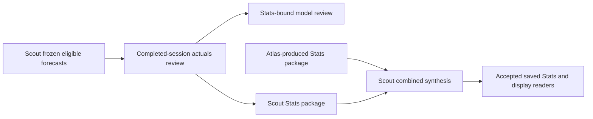

# Scout: Stats and model feedback

**Status: completed Scout inspection, October 11, 2026.** This companion records independently inspected Scout source and saved evidence. Read the [shared Stats explanation](../stats-and-feedback.md) for the system contract; that chapter remains Atlas-owned and was still a placeholder at this inspection. The [Scout nightly companion](nightly-workflow.md) explains orchestration, and [Scout Gameplan](gameplan.md) explains planning and acceptance.

Evidence was captured at **2026-10-11 00:06:03 PDT / 07:06:03 UTC**; native definitions were read at **00:02:36 PDT / 07:02:36 UTC**. Local times use **America/Los_Angeles**, which is PDT (UTC−07:00) on these dates. These are observation times, not launch or completion times. Ducketz HEAD was `9c5b50281169f05032bb0d6d943f761447e70cab`, with pre-existing modified and untracked source. Current working bytes support the findings below; a private inventory records each inspected file's SHA-256. No application workflow, provider request, training, prediction generation, trading action or worker control was used for this inspection.

The installed coordination profile identifies this PC as Scout. The pinned release manifest and its 29 listed files matched. The strict installation check separately failed on pre-existing extra Python cache files; that distinction remains recorded privately and was not repaired here. Coordination verification does not certify application source or runtime operation.

## Local responsibility and evidence flow

Scout prepares completed-session Stats for its research responsibility, submits an exact Stats package alongside local planning output, and performs configured combined synthesis. Peer observations remain attributed to their producing package. Atlas's installed definitions and live runtime were not inspected from Scout.

| Local input or output | Meaning and boundary |
| --- | --- |
| Frozen forecast and matching saved plan | Actuals review selects the last verified independent-stock edition saved before the reviewed session's 04:00 Pacific opening. Probabilities, targets and identities remain frozen. Later preparation cannot invent earlier eligible forecasts. |
| Completed market observations | The forecast's own price-source contract supplies evidence through the completed session's 17:00 Pacific cutoff. Completed-minute availability, dataset identity and conflicting duplicate observations are checked. |
| Local Stats run | Receipt, manifest, forecast outcomes, planning-price comparisons and report, bound by latest and dated selectors. These are market outcomes, not fills. |
| Model-review proposal | Bound to the exact Stats receipt, results/report hashes, target contract and nine source-policy hashes. A review supplies candidates or `KEEP_CURRENT`; it does not itself fit or promote. |
| Local Stats package | Allowlisted forecast outcomes, producer, session, coverage and source hashes, carried through the separately authorized private nightly exchange. Package integrity does not supply export authority. |
| Combined Stats | Exactly two producer packages for one session, nonoverlapping ownership, compatible target semantics and exact byte/reference validation. Default and dated readers must select the accepted combined publication for downstream readiness. |

Source references S1–S6 below identify these interfaces. Full packages, exact symbol membership, bindings, native IDs and receipts stay private.

## Installed task relationships

Saved native definitions observed October 11 at **00:02:36 PDT** support this table. All listed definitions were ACTIVE. A recurrence establishes scheduling; it does not prove launch, process liveness or component completion. Those evidence levels remain separate in the [nightly companion](nightly-workflow.md).

| Saved display name | Pacific schedule and model | Stats relationship |
| --- | --- | --- |
| Scout DATASTORE CATCH-UP | Daily 21:05 and 04:05; `gpt-6-luna`, low | Completes local data prerequisites. Simultaneous downstream wakes cannot skip the dependency. |
| Scout GAMEPLAN STATS | Daily 21:05; `gpt-6-luna`, low | Owns `prepare_stats` after datastore completion; its numerical stage publishes completed-session Stats before model review. |
| Scout MODEL REVIEW, TRAINING & PREDICTING | Daily 21:05; `gpt-6-luna`, low | Owns downstream review/training. This native model setting is distinct from the configured reviewer and numerical worker described in the nightly companion. |
| Scout GAMEPLAN SYNTHESIS | Monday–Friday, every 20 minutes, 21:00–23:40; `gpt-6-astra`, ultra | Consumes exact local and peer planning/Stats evidence and produces the combined handoff when dependencies permit. |
| Scout GAMEPLAN SYNTHESIS after midnight | Tuesday–Saturday, 00:00, 00:20 and 00:40; `gpt-6-astra`, ultra | Continues the same logical evening responsibility with shared continuity state. |
| Scout DUCKETZ DISPLAY | Daily 03:00 and 03:35; `gpt-6-luna`, low | Checks saved downstream readiness and owns established risk/missed-confirmation notifications. A successful wake is not publication acceptance. |

Current source separates split responsibilities from the older five-step/monolithic route. The legacy weekly forecast-review task documented in [scheduled tasks](scheduled-tasks.md) must not be mistaken for the active daily Stats prerequisite. This work changed no schedules or controls.

## Interpreting the saved outcomes

Maturity belongs to each frozen target endpoint. The independent-stock source defines hourly windows, a non-entry opening-gap research row, four-action-hour windows including next-session continuation, five daily session rows, and the first-session-to-fifth-session weekly endpoint. XNYS determines sessions; the named windows use Pacific clocks. A daily completed-session review can retain longer targets as `PENDING_MATURITY`; cumulative evaluation can later score their original windows. [S1, S2]

An outcome is `EVALUATED` only when mature, ordered, eligible endpoint observations exist. An ended window lacking eligible prices is `MATURE_AWAITING_DATA`. Selection preserves the five-minute boundary tolerance and observation timestamps. Missing prices are not filled and absent observations do not establish that no trades occurred. Earlier hourly price comparisons use opening observations; 17:00 uses a completed-minute close. Source-request coverage is separate from eligible-price availability. [S1]

Observed scored editions use `raw-price-direction-v1` (YG), whose positive class is a strictly positive raw return. Legacy OG rows without an explicit contract retain the cost-adjusted positive-return target. Brier scores retain each edition's target; different nonempty target contracts cannot be combined. UI directional accuracy compares the saved bullish/bearish call with raw price movement. Neutral evaluated rows can contribute Brier evidence but have no directional score. Pending, missing and unpromoted rows do not contribute to UI performance. [S2–S4]

The cumulative evaluator's historical `direction_accuracy` instead compares the probability-threshold classification with its binary target; `raw_direction_accuracy` uses saved directional calls. Neither label should silently replace the UI's metric. All-row completion counts are also different from a promoted/scored denominator. Planning midpoint errors and range coverage evaluate hypothetical planning estimates at saved clocks. Forecast scores and planning comparisons do not measure actual trading performance. [S1–S3]

Feedback includes horizon-level missing-data and limited-support alerts and requires a decision for every horizon. No completed observations requires `KEEP_CURRENT` with no candidates. Bounded parameter/architecture proposals remain subject to chronological development selection, calibration boundaries and separate promotion gates. Reviewers cannot alter features, splits, target definitions, seeds or promotion policy. [S5]

## Saved outcomes and acceptance on Scout

All nine saved actuals-review runs in the inspected inventory passed recorded manifest-output hash/size and receipt-to-manifest checks. Selected outcome columns were read without an evaluator or model load. Counts below describe frozen publications, not a new rescore. Exact paths and hashes remain in the private report.

| Reviewed session; publication time in PDT | Saved all-row outcomes | Evidence meaning |
| --- | --- | --- |
| October 2 local; October 2, 23:00:32 | 264 rows: 110 evaluated, 66 pending, 88 awaiting data | 263 promoted rows; one unpromoted row excluded from UI performance. All 110 evaluated rows were scored directional calls. |
| October 7 local; October 7, 22:33:00 | 264 rows: 106 evaluated, 66 pending, 92 awaiting data | Completed-session Stats before training, retaining longer-window and missing-data limits. |
| October 7 combined; October 8, 00:21:55 | 528 rows: 273 evaluated, 132 pending, 123 awaiting data | Both producer entries report saved forecasts. This is Scout's retained combined artifact, not a live Atlas observation. |
| October 8 local; October 9, 08:33:32 | 264 rows: 104 evaluated, 66 pending, 94 awaiting data | A late local review; the real review time is preserved. |
| October 8 combined; October 9, 13:22:34 | 528 rows: 270 evaluated, 132 pending, 126 awaiting data | Combined artifact checked locally; it does not establish when Atlas installed or displayed it. |
| October 9 local; October 9, 21:48:26 | Zero rows; `NO_SAVED_INDEPENDENT_GAMEPLAN` | Explicit no-eligible-history baseline. Later saved work cannot retroactively become the session's pre-opening forecast. |
| October 9 combined; October 10, 03:24:46 | Zero rows; both producers report the no-history baseline | Current latest and dated selectors agree and match the receipt. A completed publication exists, but there is no forecast score for this session. |

October 1 and October 6 local no-history baselines remain in the nine-run history. The separate cumulative evaluator, observed at **October 9 22:06:34 PDT**, reports 1,320 rows: 569 evaluated, 143 pending and 608 awaiting data. Its pointer, receipt, manifest and four output hashes passed. Its historical population differs from selected daily Stats.

For the latest local workflow, `prepare_stats` completed **October 9 21:48:32 PDT**, model review completed **21:53:38**, and local preparation/handoff completed **22:28:28**. The local terminal state retained `LOCAL_COMPLETE_PEER_SETUP_PENDING`. The selected synthesis receipt separately records `JOINT_READY_LOCAL`, with local UI readiness true and peer verification false at that layer. A later saved exchange status records `COMPLETE` with joint, peer and UI readiness true. The dated receipt hash, three Stats file references, Stats receipt binding and producer package-hash references matched retained bytes/metadata. These records establish separate stages; an earlier pending label was not erased to imply joint completion.

This supports saved acceptance on Scout. It is not a fresh complete semantic acceptance validation, current Atlas liveness check, or rendered UI/trader test. Saved exchange status keeps execution authorization false and activation unchanged. Planning completion does not authorize trading.

## Source drift and material limits

Four saved feedback records were inspected. Every proposal matched its diagnostics hash and all four bound Stats files. Every inspected horizon decision was `KEEP_CURRENT` with no candidates. The latest proposal, reviewed October 9 at **21:53:38 PDT**, used the zero-history baseline and supplies no completed forecast support from that session.

The latest review differs from current working bytes in **one of nine** recorded source-policy files: `app/ui/gameplan_stats_data.py`. Each of the three older reviews also differs in `ml/nightly_gameplan.py`. Matching HEAD alone does not authorize fresh training. The ordinary loader requires current policy and Stats identities. A separate terminal-history attestation preserves completed historical review against original frozen files and policy hashes; it never feeds training. Unfinished work still uses ordinary current-code validation. [S5, S6]

This inspection checked retained output bytes and selected references, not every historical market input or price derivation, financial packet semantics, historical process liveness or future schedule execution. Exact operational evidence was not republished. Independent Atlas observations remain necessary for Atlas's companion; shared chapter and index integration remain Atlas-owned.

## Evidence and source references

Scout retains `scout-stats-and-feedback-2026-10-11.md`, `evidence.json`, `saved-row-evidence.json`, `inventory.json` and `verify_stats_evidence.py` privately in the dated task evidence directory. The report resolves exact originals and hashes. These private files are intentionally not repository links or publication attachments.

| Reference | Inspected current Ducketz source and entry points |
| --- | --- |
| S1 | `ml/gameplan_actuals_review.py`: `completed_session_context`, `_latest_saved_gameplan`, `_saved_trade_plan`, `compare_forecasts`, `compare_price_points`, `_publish_session_review`; `ml/independent_stock_targets.py`: `stock_target_windows`. |
| S2 | `ml/gameplan_probability_target.py`: OG/YG contracts; `ml/gameplan_evaluation.py`: `evaluate_forecasts`, `compare_gameplan_variants`, `evaluate_saved_gameplans`; `ml/directional_forecast_evaluation.py`: separate forecast-only history. |
| S3 | `app/ui/gameplan_stats_data.py`: `prediction_metrics`, `_outcome`, `load_gameplan_stats`; `app/ui/gameplan_stats.py`: saved session selection, filters, refresh and explicit empty-history display. |
| S4 | `ml/gameplan_stats_handoff.py`: `_validate_package`, `export_stats_package`, `combined_stats_target`, `adopt_combined_stats`. |
| S5 | `ml/gameplan_model_feedback.py`: `_stats`, `_validate_proposal`, `_verify_diagnostics`, `load_feedback_review`; `ml/gameplan_development_selection.py`, `ml/calibration.py`, `ml/gameplan_promotion.py`: development, calibration and promotion separation. |
| S6 | `ml/nightly_workflow.py`: `verify_display`, `_completed_feedback`, `_verify_local_preparation`, local Stats export; `ml/nightly_synthesis.py`, `ml/nightly_handoff.py`, `ml/nightly_joint_readiness.py`: exact combined selections and downstream readiness. |

These paths belong to the application checkout. Some modules remain untracked at its recorded HEAD; a commit link would not identify their observed bytes. The private SHA-256 inventory is the exact evidence reference. The owned companion was reviewed for attribution, chronology, evidence stability, relative links and substantive privacy before publication.

Related: [Scout scheduled tasks](scheduled-tasks.md), [Scout Gameplan](gameplan.md), [Scout nightly workflow](nightly-workflow.md), [system details index](../README.md).
