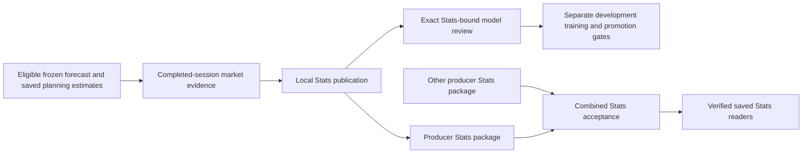

# Stats and model feedback

**Status: reviewed shared implementation reference, October 11, 2026.** Atlas owns this shared explanation. It describes the inspected implementation, not either PC's installed schedule or latest outcome. Those observations belong in the [Atlas companion](atlas/stats-and-feedback.md) and [Scout reviewed companion](https://github.com/jeremysecondstate/atlas-scout/blob/8b1ef9d547adbaa8ece26de585ce0ef126c70215/system-details/scout/stats-and-feedback.md).

Source snapshots were taken **October 11, 2026, 00:34–00:36 PDT (07:34–07:36 UTC)** from Ducketz HEAD `90704d21801f60426493bd6cc650a7fac38d4f61` with pre-existing changes. The evidence index distinguishes clean tracked source from modified and untracked working files. Private snapshots and SHA-256 inventories identify the inspected bytes; the commit alone does not. No application import, evaluation, training, provider request or runtime action was used for this investigation.

## Purpose and boundary

Stats compares an already frozen forecast with eligible market observations and preserves the distinction between completed, immature and missing outcomes. It also compares saved planning-price estimates with observed prices. These are forecast and hypothetical-planning measurements; they do not establish broker fills, realized account profit or actual trading performance. Model feedback consumes the verified Stats publication and proposes bounded development candidates. Numerical fitting, calibration, assessment and promotion occur separately in Gameplan preparation. [S1–S5]

The completed-session entry point is `publish_completed_session_review`: it can publish Stats before fitting or preparing the successor Gameplan. The older `publish_actuals_review` route requires a completed successor and its planning output. Both use the same frozen historical selection and output family. The cumulative saved-Gameplan evaluator is a separate history-wide product, not the selected daily Stats tab. [S1, S3]

## Eligible evidence and clocks

`completed_session_context` uses the XNYS calendar. It selects a completed action session and its **17:00 America/Los_Angeles** outcome cutoff; a wake before that boundary uses the previous exchange session. An explicit non-session or not-yet-completed session fails validation. The successor is the next exchange session. These calendar clocks follow Pacific daylight-saving rules and are distinct from observation/publication timestamps. [S1]

For the reviewed session, Stats selects the latest verified independent-stock publication saved **strictly before its 04:00 Pacific opening**. A matching optional trade plan must also be complete before that opening, bind the exact forecast receipt, and retain the same identities and frozen target fields. Later preparation or an authorized late successor does not make a newly generated forecast eligible for that earlier historical opening. [S1]

No eligible forecast produces an explicit `NO_SAVED_INDEPENDENT_GAMEPLAN` publication with zero outcome rows. The newer completed-session route labels that empty baseline with the current target contract for display/training intent; it does not fabricate a historical forecast. An empty score is unavailable, not zero accuracy. If forecasts exist but a matching saved price estimate does not, forecast evaluation can still proceed while the price comparison records its missing estimate. [S1, S5]

Independent-stock target definitions remain frozen with each edition:

| Target group | Declared windows and eligibility |
| --- | --- |
| Hourly | Thirteen 04:00–17:00 forward-hour windows, plus a prior-session 17:00-to-current-04:00 opening-gap research row that is not an entry. |
| Four-hour | Entries at 04:00, 08:00, 12:00 and 16:00. The final window continues after the closed interval into the next session, ending at 07:00. |
| Daily | Five separate 04:00–17:00 session rows; only the first is an execution entry and the others are outlook rows. |
| Weekly | First-session 04:00 through fifth-session 17:00, including overnight exposure. |

The 24-row contract is per researched symbol, not a statement about either PC's universe or positions. Maturity belongs to the original endpoint: a daily review can retain longer windows as `PENDING_MATURITY`, while the separate cumulative evaluator may score them later. [S2, S3]

Actual-price loading uses the forecast's declared source contract and dataset. Only completed one-minute observations are admitted; conflicting duplicates fail. Endpoint observations use the existing five-minute tolerance: ordinary entries use the first qualifying open at/after the boundary, exits use the last qualifying completed-minute close at/before it; the opening-gap research row reverses those endpoint kinds. Source-request coverage is recorded separately from observed-price availability. An absent bar is not proof that no trades occurred, and Stats does not fill absent actual prices with planning estimates. [S1, S2]

## Metrics and denominators

| Measure | Implemented meaning |
| --- | --- |
| `EVALUATED` | The target has matured and eligible, correctly ordered entry/end observations exist. |
| `MATURE_AWAITING_DATA` | The target has ended but the required eligible endpoint evidence is unavailable. |
| `PENDING_MATURITY` | The original target endpoint is after the evaluation cutoff. |
| UI directional accuracy | Correct saved bullish/bearish calls divided by scored directional calls, using the sign of raw observed return. A flat move is not a successful bullish or bearish call. |
| UI Brier score | Mean squared error between frozen probability and that edition's binary target; evaluated neutral rows can contribute. |
| Planning-price error/range coverage | Difference between eligible observed market prices and the separately saved hypothetical midpoint/range at the same declared clocks. |

The UI first excludes unpromoted forecast rows. Pending and missing rows do not enter performance denominators; evaluated neutral rows enter Brier evidence but not directional accuracy. Total saved rows, promoted rows, evaluated rows and scored directional calls are different populations. The reader recomputes each accepted target and Brier value and checks the saved direction result. [S1, S4]

The explicit `raw-price-direction-v1` contract (YG) uses strictly positive raw return as the positive class. Legacy rows without an explicit contract retain `cost-adjusted-positive-return-v1` (OG), whose positive class exceeds the saved assumed round-trip cost. These are probability-label definitions, not realized net account returns. Directional UI accuracy still uses raw movement for both. Different nonempty probability targets cannot be averaged into one combined Stats publication. [S3–S5, S8]

The cumulative evaluator's historical `direction_accuracy` instead compares `probability >= 0.5` against that edition's binary target. It separately retains `raw_direction_accuracy` for saved calls. Its population includes frozen editions across history and is not interchangeable with the daily promoted-only UI population. An already evaluated immutable forecast retains its original scored outcome; changed probability, target, cost, direction or endpoint evidence fails the relevant checks rather than silently relabeling it. OG/YG comparison pairs identical observed windows and does not choose the best historical edition after seeing results. [S3]

## Publications and consumers

| Input/output | Acceptance and consumer boundary |
| --- | --- |
| Local review | Immutable run containing forecast outcomes, price comparisons, report and rendered results; a manifest binds output hashes/sizes, and a COMPLETE receipt binds the manifest and session. |
| Latest/dated selectors | Bind the review receipt. The reader checks path scope, hashes, schema, action date, required outputs and completed non-preview status before display. |
| Feedback diagnostics/proposal | Bind exact Stats receipt/manifest/results/report, target intent and nine source-policy hashes; consumed by reviewed Gameplan training. |
| Producer Stats export | Allowlisted forecast outcomes and producer/session/universe/provenance. It excludes planning prices, quantities and account state, but remains subject to the separately authorized private exchange. |
| Combined Stats | Exactly two independently selected producer packages; accepted by synthesis/handoff and verified by default and dated readers. |

Local publication verifies outputs before updating selectors. Latest and dated selectors are separate atomic file replacements, not a single multi-file transaction. A generic manifest check verifies the recorded output inventory; it does not rerun market-data derivation, prove all historical input bytes, or establish downstream workflow completion. [S1, S4, S8, S10]

Stats package validation checks producer, completed session/cutoff, explicit ownership, source digests, allowed fields, duplicate IDs/routes, row targets and observations not beyond cutoff. Export rechecks source hashes before writing immutable bytes. Combination requires the same reviewed session, nonoverlapping ownership, exact selected package digests and compatible nonempty target contracts. Both empty producers yield no-history coverage; one empty producer yields partial-history coverage. Combined output retains each producer's provenance. [S8]

Synthesis verifies both plan and Stats in a candidate before local adoption. Its existing-Stats check compares exact producer hashes, coverage metadata and rows; different combined sources for the same session fail. Default-reader verification is a distinct subsequent stage. A completed local Stats component, accepted combined Stats, selected display and completed peer exchange must be reported separately. [S9]

## Feedback, calibration and model retention

Feedback diagnostics use the verified UI metrics and retain missing-data, pending-window and limited-support alerts. Every horizon needs a named review decision and rationale. `KEEP_CURRENT` means no additional feedback candidates; it does not disable the ordinary numerical preparation stages. A horizon with no completed observations cannot receive feedback candidates. At most two bounded tree, neural or logistic specifications can be proposed per horizon; the reviewer cannot change features, splits, targets, random seeds or promotion policy. [S5, S6]

Gameplan fits candidates on chronological development data, selects on development log loss, refits the selected family on train plus selection, calibrates on a later partition and assesses on a separate final partition. Overlapping target windows are purged between partitions. Calibration selection and probability-information checks remain separate from final promotion. Independent-stock promotion uses an explicit versioned policy with baseline-error tolerances; promotion is not a claim of measured baseline outperformance. An eligible retained champion can preserve an earlier accepted model when a challenger fails; compatibility and immutable model/cohort/report evidence are checked. [S6, S7]

Ordinary feedback loading checks current source-policy hashes and, by default, the latest Stats identity; Gameplan repeats these checks after fitting. Changed current policy or Stats requires fresh review for new training. The completed-workflow attestation route is narrower: it requires a terminal workflow, all original stages complete, frozen source identity, exact saved review/output hashes and valid original Stats/diagnostics. It can attest historical acceptance without equating historical policy with today's bytes, and never feeds training. An older completed review therefore does not authorize training against later source changes. [S5–S7]

## Failures, history and evidence limits

Corrupt receipts/manifests, contradictory prices, future data, conflicting target contracts, changed export bytes and incompatible combined selections fail the inspected validators. Missing outcomes remain explicitly pending or awaiting data. Missing saved forecast history remains an explicit baseline. The Stats component does not establish a general automatic-retry guarantee; scheduling, locks, stage ownership and bounded workflow recovery are described in [nightly workflow](nightly-workflow.md). [S1, S4, S5, S8, S9]

The older successor-first actuals-review interface remains implemented alongside completed-session-before-training. The older evaluator metric name remains historical and must not silently replace UI semantics. This chapter reconciles Scout's October 11 source findings at reviewed PR #13 revision `8b1ef9d547adbaa8ece26de585ce0ef126c70215`; Scout's saved outcomes are attributed to its companion and are not independent Atlas runtime evidence.

This source inspection did not re-evaluate saved forecasts, load fitted models, verify every original market observation, render the UI or exercise recovery. Current source behavior does not prove that any historical process loaded these working bytes. Native schedules, current selections, recorded source drift and saved acceptance belong in the actor companions.

## Source evidence index

All entries were observed at **00:34–00:36 PDT, October 11, 2026**. `C` means clean tracked at the recorded HEAD, `M` tracked with local modifications, and `U` untracked working source. The private SHA-256 manifest resolves exact bytes; these classifications describe source state, not review or deployment approval.

| Ref | Source and inspected entry points/lines | State |
| --- | --- | --- |
| S1 | `ml/gameplan_actuals_review.py:43–76,87–353,481–612`: session/cutoff, actual observations, comparisons, frozen selection and publication | M |
| S2 | `ml/independent_stock_targets.py:24–118`; `ml/gameplan_price_bands.py:42–69`: target windows, endpoint tolerance and source identity | C |
| S3 | `ml/gameplan_probability_target.py:15–50`; `ml/gameplan_evaluation.py:101–252`: target definitions, cumulative metrics and retained evaluation | C |
| S4 | `app/ui/gameplan_stats_data.py:35–149,214–333`: metrics, row validation and publication reader | M |
| S5 | `ml/gameplan_model_feedback.py:24–303`: Stats/code binding, bounded proposals, diagnostics and ordinary loading | U |
| S6 | `ml/nightly_gameplan.py:199–205,389–442,598–613,1355–1590,1825–1875`: feedback training, revalidation and chronological fitting | M |
| S7 | `ml/gameplan_development_selection.py:59–135` (C); `ml/gameplan_promotion.py:39–105` (C); `ml/gameplan_champions.py:26–184` (M); `ml/nightly_workflow.py:450–499` (U): calibration, promotion, retention and terminal historical attestation | Mixed |
| S8 | `ml/gameplan_stats_handoff.py:57–258`: export validation, immutable package, combined target/coverage and publication | U |
| S9 | `ml/nightly_synthesis.py:158–301`; `ml/nightly_handoff.py:157–228`: exact existing Stats, candidate checks, partial adoption and readiness | U |
| S10 | `ml/artifacts.py:151–172`: output-only manifest integrity scope | C |

Related: [Gameplan](gameplan.md), [nightly workflow](nightly-workflow.md), [system details index](README.md).
